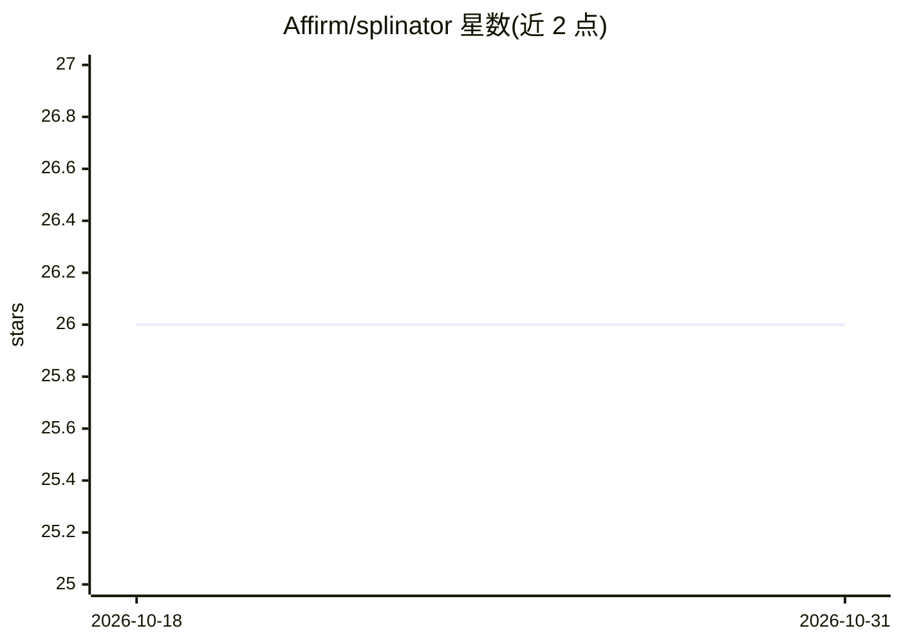

# Affirm/splinator

⭐ 26 · Python · BSD-3-Clause · 推送 2026-09-01 · [GitHub](https://github.com/Affirm/splinator) · [官网](https://affirm.github.io/splinator/) · 组织维护

**scikit-learn 兼容的概率校准工具包，含校准器与校准度量**

Afferm 维护的 Python 概率校准工具包：提供 LinearSplineLogisticRegression（分段线性）与 TemperatureScaling 两种校准器，配套 refinement loss、logloss/brier 分解、ECE、Spiegelhalter's z 等度量；支持通过 metric wrapper 将校准感知度量接入 XGBoost/LightGBM 的早停训练。面向使用 scikit-learn 生态的机器学习开发者，附 Jupyter 示例与相关论文引用，开发环境基于 uv 与 pytest。

## 筛选速览

| 维度 | 判定 | 备注 |
|---|---|---|
| AI 角色 | `ai-native` | 本体是模型或模型工具 |
| 许可风险 | `permissive` | BSD-3-Clause |
| 部署形态 | `library` | 以包/库形式分发 |
| 模型依赖 | — | README 未给出锁定关系 |
| 硬件要求 | — | 无带数字的原话,不猜 |
| 安装摩擦 | `low` | 无编译、无系统依赖或容器化 |
| 成熟度 | — | 结构信号不足 |

## 能力要点

- LinearSplineLogisticRegression 与 TemperatureScaling 校准器
- ECE、Spiegelhalter's z、logloss/brier 分解等校准度量
- metric wrapper 接入 XGBoost/LightGBM 早停
- 与 scikit-learn 兼容，pip 安装

## 适用场景

- 训练后校正分类器的预测概率
- 评估模型概率校准质量
- 用校准感知度量做梯度提升模型早停

## 场景标签

`MLOps` · 领域:训练与推理

## 证据(README 行号)

> L5: A scikit-learn compatible toolkit for measuring and improving probability calibration.
> L23: |**Calibrators**|`LinearSplineLogisticRegression` (piecewise), `TemperatureScaling` (single param)|

## 星数曲线

2026-10-18 26 → 2026-10-31 26（+0）

---
*卡片 v1 · prompt 1.4 · 生成 2026-10-26 · 置信度 high · 依据 README sha `0bd6c575963b` · [字段定义](../../DATASET.md)*
