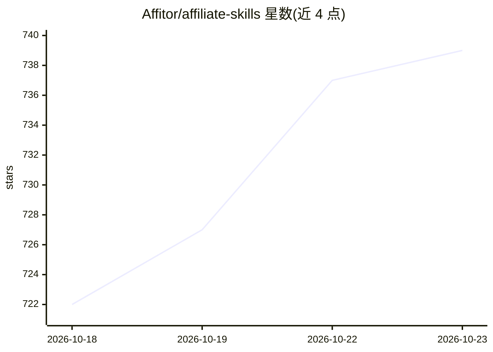

# Affitor/affiliate-skills

⭐ 739 · HTML · MIT · 推送 2026-10-19 · [GitHub](https://github.com/Affitor/affiliate-skills) · [官网](https://affitor.com) · 组织维护

**面向联盟营销的 52 个 AI agent 技能集（8 阶段闭环）**

以纯 Markdown SKILL.md 形式定义的 52 个技能，覆盖联盟营销 8 个阶段：程序调研（openaffiliate.dev 数据源）、趋势内容侦察、研究驱动的内容写作、SEO 博客、落地页生成、部署分发、转化跟踪与自动化、合规审计。每个技能带类型化输入输出 schema 与 chain_metadata/suggested_next 支持自动链式调用。兼容 Claude Code、Pi、ChatGPT、Gemini、Cursor、Windsurf 等任意读取文本的 AI；提供 affiliate-check CLI 与可选 hidrix-tools MCP 服务器补充实时社交数据。

## 筛选速览

| 维度 | 判定 | 备注 |
|---|---|---|
| AI 角色 | `ai-knowledge` | 知识聚合/清单类 |
| 许可风险 | `permissive` | MIT |
| 部署形态 | `library` | 以包/库形式分发 |
| 模型依赖 | — | README 未给出锁定关系 |
| 硬件要求 | — | 无带数字的原话,不猜 |
| 安装摩擦 | `low` | 无编译、无系统依赖或容器化 |
| 成熟度 | — | 结构信号不足 |

## 能力要点

- 52 个技能按 8 阶段组织，S6 分析数据回流 S1 形成闭环
- 每个技能带输入输出 schema 与 suggested_next 支持自动链式调用
- 纯 Markdown 技能定义，任意 AI 可用，另提供 npx/git clone 安装
- 配套 hidrix-tools MCP 服务器提供 16 个实时社交数据工具

## 适用场景

- 让 AI agent 调研联盟计划并生成数据支撑的推广内容
- 搭建从研究到部署、跟踪、优化的联盟营销工作流
- 对联盟营销内容做 FTC 合规审计

## 场景标签

`工作流自动化` `AI 写作` · 领域:效率与自动化

## 证据(README 行号)

> L5: 52 AI-powered skills across 8 stages with a closed-loop flywheel. Research programs, scout trending content, write d
> L15: - `skills/{stage}/{skill-name}/SKILL.md` — main skill definitions
> L18: - `registry.json` — machine-readable skill catalog
> L237: Machine-readable index: `registry.json` · API docs: `API.md` · Skill template: `template/SKILL.md` · Spec: `spec/`

## 星数曲线

2026-10-18 722 → 2026-10-23 739（+17）

---
*卡片 v1 · prompt 1.4 · 生成 2026-10-21 · 置信度 high · 依据 README sha `9a024c3267c2` · [字段定义](../../DATASET.md)*
