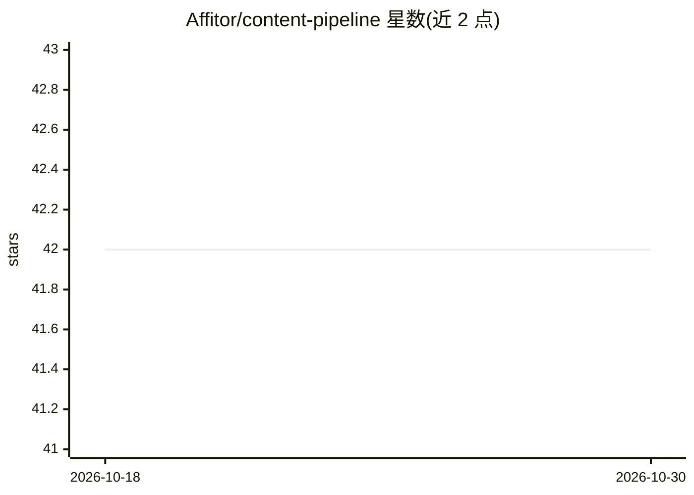

# Affitor/content-pipeline

⭐ 42 · TypeScript · MIT · 推送 2026-09-12 · [GitHub](https://github.com/Affitor/content-pipeline) · [官网](https://affitor-content-pipeline.vercel.app) · 组织维护

**AI 内容管线：检索热点并生成带品牌插图的 LinkedIn 帖子**

基于 Next.js 16 的 Web 应用，面向需要批量产出 LinkedIn 内容的用户：通过 Brave Search API 检索新闻/博客等趋势文章，按格式（Toplist、POV 等）、语气、长度、语言（EN/VN）配置后，用 Claude Sonnet 4 流式生成帖子，所有选中文章作为上下文、每篇帖子侧重不同主源以产出不同角度；再用 Satori 服务端渲染 1080x1350 品牌信息图。需自备 Kyma API 与 Brave Search API 密钥，支持 Vercel 一键部署或本地 npm 运行。

## 筛选速览

| 维度 | 判定 | 备注 |
|---|---|---|
| AI 角色 | `ai-native` | 本体是模型或模型工具 |
| 许可风险 | `permissive` | MIT |
| 部署形态 | `library` | 以包/库形式分发 |
| 模型依赖 | locked-api |  |
| 硬件要求 | — | 无带数字的原话,不猜 |
| 安装摩擦 | `low` | 无编译、无系统依赖或容器化 |
| 成熟度 | — | 结构信号不足 |

## 能力要点

- Brave Search 检索趋势文章，支持 News/LinkedIn/YouTube/Blogs 过滤与自动标签
- Claude Sonnet 4 流式生成帖子，多篇文章作上下文产出不同角度
- Satori 服务端渲染 1080x1350 品牌信息图
- 支持格式/语气/长度/语言（EN/VN）/输出数量配置

## 适用场景

- 围绕行业热点快速产出多条不同角度的 LinkedIn 帖子
- 为帖子配带品牌样式的信息图
- 本地或 Vercel 部署私有内容生成实例

## 场景标签

`AI 写作` `网页抓取` `图像生成` · 领域:效率与自动化

## 证据(README 行号)

> L15: - **Write** - Generate LinkedIn posts with Claude Sonnet 4, streamed in real-time. All selected articles used as co
> L25:   → Claude writes posts (streaming, each with a different angle)

## 星数曲线

2026-10-18 42 → 2026-10-30 42（+0）

---
*卡片 v1 · prompt 1.4 · 生成 2026-10-25 · 置信度 high · 依据 README sha `c291ba16002c` · [字段定义](../../DATASET.md)*
