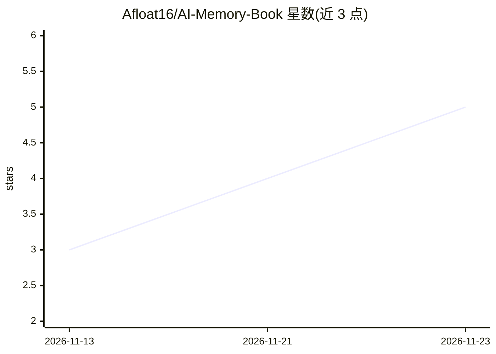

# Afloat16/AI-Memory-Book

⭐ 5 · Python · MIT · 推送 2026-11-19 · [GitHub](https://github.com/Afloat16/AI-Memory-Book) · 个人维护 · 中文 README

**给 AI 编程客户端提供本地化、可溯源的对话记忆书库**

以 Python + SQLite/FTS5 实现的本地记忆存档：把项目保存为书、任务为章、问答为节，并保留原始证据页及可追溯地址；支持标题/问题索引检索、中英文词汇检索与命名别名、2,400 字符默认预算和最多五条结果。通过 MCP 接入 Claude Code、Codex、Gemini 等客户端，默认摄取与词法召回不调用模型。提供安装脚本、doctor 检查与在线备份；基准结果为作者自建测试集，非独立验证。

## 筛选速览

| 维度 | 判定 | 备注 |
|---|---|---|
| AI 角色 | `ai-ecosystem` | LLM/agent 周边工具 |
| 许可风险 | `permissive` | MIT |
| 部署形态 | `None` |  |
| 模型依赖 | — | README 未给出锁定关系 |
| 硬件要求 | — | 无带数字的原话,不猜 |
| 安装摩擦 | `low` | 无编译、无系统依赖或容器化 |
| 成熟度 | — | 结构信号不足 |

## 能力要点

- 项目→章节→证据页的书式结构与地址化引用
- SQLite/FTS5 本地运行，默认摄取与词法召回无模型调用
- MCP 连接可绑定具体项目 ID，多客户端共享同一存档
- 提供 v0.12/v0.13 回放基准与外部检索组件对比数据

## 适用场景

- 跨会话恢复工程任务中的决策、修正与失败尝试
- 在相似代码库间隔离各项目的记忆命名空间
- 为 Claude Code/Codex/Gemini 等客户端接入共享记忆存档

## 场景标签

`Agent 记忆` · 领域:Agent 开发

## 证据(README 行号)

> L3: **Give AI an addressable book of engineering memory, with a separate book for each project.**
> L31: |Switch clients|One archive shared across supported Claude Code, Codex, Gemini and other integrations|
> L32: |Operate locally|SQLite / FTS5; default ingestion and lexical recall make no model calls|

## 星数曲线

2026-11-13 3 → 2026-11-23 5（+2）

---
*卡片 v1 · prompt 1.4 · 生成 2026-11-21 · 置信度 high · 依据 README sha `134d0312a196` · [字段定义](../../DATASET.md)*
