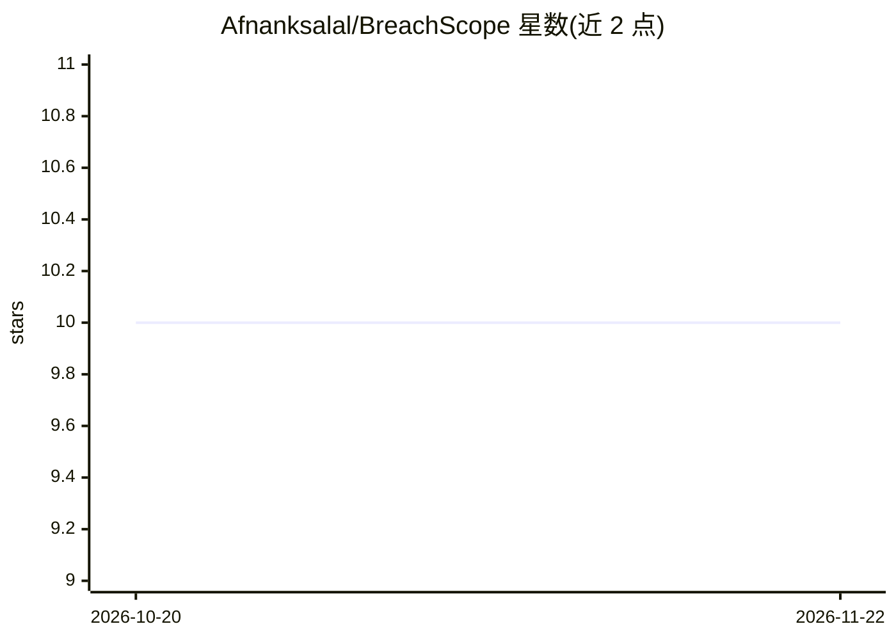

# Afnanksalal/BreachScope

⭐ 10 · TypeScript · MIT · 推送 2026-06-06 · [GitHub](https://github.com/Afnanksalal/BreachScope) · [官网](https://breachscoope.vercel.app) · 个人维护

**面向开发团队的供应链与工具链安全扫描 CLI 和仪表盘**

本地优先的安全工作流工具，扫描源代码、依赖图、lockfile、在线 URL、SaaS 工具链与 Docker 沙箱攻击路径，产出 SARIF、SBOM、OpenVEX、策略决策、基线、修复建议与审计日志等发布证据。覆盖 npm/PyPI/Go/Cargo 等 10 个生态的 CVE 匹配，按可利用性、EPSS、KEV 等做噪音分诊，并支持可选 LLM 对边界发现补充推理（含确定性护栏）。需 Node.js >=20.19，通过 npm 全局安装，附带 Next.js 仪表盘。

## 筛选速览

| 维度 | 判定 | 备注 |
|---|---|---|
| AI 角色 | `ai-enhanced` | 去掉 AI 部分产品仍成立 |
| 许可风险 | `permissive` | MIT |
| 部署形态 | `library` | 以包/库形式分发 |
| 模型依赖 | — | README 未给出锁定关系 |
| 硬件要求 | — | 无带数字的原话,不猜 |
| 安装摩擦 | `low` | 无编译、无系统依赖或容器化 |
| 成熟度 | — | 结构信号不足 |

## 能力要点

- 跨 10 个语言生态的 OSV CVE 匹配与确定性 0-100 供应链风险评分
- 噪音分诊：按可利用性、VEX、EPSS、KEV 分类 show/review/hide
- 可选 LLM 分诊并带确定性护栏，防止隐藏已确认利用与高危发现
- 证据输出覆盖 SARIF、CycloneDX、SPDX、OpenVEX 与 Markdown 修复简报

## 适用场景

- 发布前对项目做一次命令式的安全扫描并生成合规证据
- AppSec 团队用 policy-as-code 与基线管理 CVE 噪音
- CI 中生成 SARIF 接入 GitHub Advanced Security 等平台

## 场景标签

`网络安全` · 领域:学习与行业

## 证据(README 行号)

> L10: BreachScope is a local-first CLI and dashboard for finding security risk before it reaches production. It scans sou
> L71: - Use `--llm-triage` to let the configured LLM add reasoning for borderline findings. Deterministic guardrails prev

## 星数曲线

2026-10-20 10 → 2026-11-22 10（+0）

---
*卡片 v1 · prompt 1.4 · 生成 2026-11-20 · 置信度 mid · 依据 README sha `1a8f025a1a02` · [字段定义](../../DATASET.md)*
