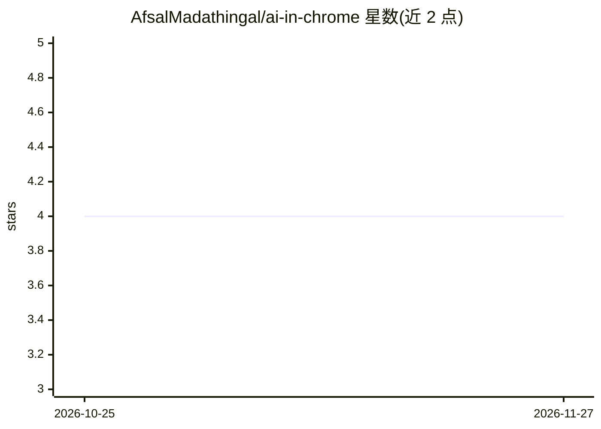

# AfsalMadathingal/ai-in-chrome

⭐ 4 · JavaScript · MIT · 推送 2026-11-17 · [GitHub](https://github.com/AfsalMadathingal/ai-in-chrome) · 个人维护

**让终端 AI（Claude Code/Codex/MCP 客户端）操控已登录 Chrome 的扩展**

由 Chrome 扩展、原生宿主、本地桥接与 aichrome CLI 组成的浏览器控制系统：扩展通过 Chrome DevTools Protocol 在用户真实、已登录的浏览器标签页中执行点击、输入、截图、表单填充、网络抓包与请求重放/改写等操作。AI 侧不内置于本产品，而是复用用户已登录的 Claude Code/Codex、Ollama 本地模型或 Apple 端侧模型，也可经 MCP 接入任意客户端，或完全不用 AI 直接敲 CLI 命令。提供

## 筛选速览

| 维度 | 判定 | 备注 |
|---|---|---|
| AI 角色 | `ai-ecosystem` | LLM/agent 周边工具 |
| 许可风险 | `permissive` | MIT |
| 部署形态 | `None` |  |
| 模型依赖 | local-ok | 支持本地模型 |
| 硬件要求 | — | 无带数字的原话,不猜 |
| 安装摩擦 | `low` | 无编译、无系统依赖或容器化 |
| 成熟度 | — | 结构信号不足 |

## 能力要点

- 三种驱动方式：侧边栏聊天、任意 MCP 客户端接入、无 AI 的 aichrome CLI
- 驱动用户真实已登录的 Chrome（会话/cookies/扩展保留），经 DevTools Protocol 执行真实鼠标键盘事件
- 网络调试：捕获真实 Cookie/Authorization 头、复制为 curl、带编辑重放、实时 mock/改写、HAR 导出
- 安全机制：先询问后执行（Allow once/Always allow/Deny）、只读操作自动放行、页面可视化指示器

## 适用场景

- 让已付费使用的终端 AI 直接操作浏览器完成网页任务
- 抓取带真实登录态的网络请求并以 curl 复现或改写调试
- 在开发者的网页应用上端到端调试流量与响应
- 不借助 AI，用 CLI 脚本批量执行浏览器操作

## 场景标签

`浏览器自动化` · 领域:效率与自动化

## 证据(README 行号)

> L5: **Claude in Chrome for any AI you already use.** Your terminal AI (Claude Code, Codex, or any MCP client) drives you
> L10: side panel / aichrome CLI / any MCP client ──► local bridge (socket or named pipe) ──► native host (started by Chro
> L20: - **Three ways to drive it.** Chat in the side panel, connect any AI over MCP, or type `aichrome` commands yourself

## 星数曲线

2026-10-25 4 → 2026-11-27 4（+0）

---
*卡片 v1 · prompt 1.4 · 生成 2026-11-21 · 置信度 high · 依据 README sha `894392de5714` · [字段定义](../../DATASET.md)*
