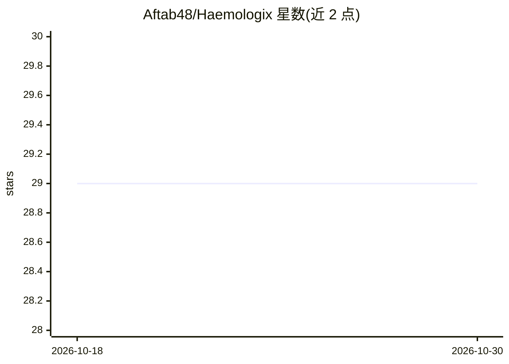

# Aftab48/Haemologix

⭐ 29 · TypeScript · NOASSERTION · 推送 2026-10-09 · [GitHub](https://github.com/Aftab48/Haemologix) · [官网](https://www.haemologix.in) · 组织维护

**印度实时紧急血液供需网络平台，连接医院血库与献血者**

面向印度医疗场景的紧急血液网络 Web 应用：医院发布血液/血浆/血小板需求，系统按血型、距离与 WHO 依据的资格规则匹配献血者，实时通知并一键响应，全程追踪捐赠历史与分析。技术栈为 Next.js 15 + TypeScript + PostgreSQL(NeonDB) + Prisma，含 6 个 AI agent（协调/献血者/医院/库存/物流/筛查）、OCR 医院文件核验、需求预测（PyTorch 训练管线、Hugging Face 推理）与 LLM（Claude 4.5 Sonnet 经 OpenRouter）。由 Haemologix Private Limited 开发运营，线上运行于 haemologix.in，本地可用 npm 或 Docker 运行。

## 筛选速览

| 维度 | 判定 | 备注 |
|---|---|---|
| AI 角色 | `ai-enhanced` | 去掉 AI 部分产品仍成立 |
| 许可风险 | `permissive` | NOASSERTION |
| 部署形态 | `self-host` | docker 或自建部署 |
| 模型依赖 | — | README 未给出锁定关系 |
| 硬件要求 | — | 无带数字的原话,不猜 |
| 安装摩擦 | `low` | 无编译、无系统依赖或容器化 |
| 成熟度 | — | 结构信号不足 |

## 能力要点

- 按血型、地理距离与 WHO 资格规则的献血者匹配与实时通知
- 6 个事件驱动 AI agent（协调/献血者/医院/库存/物流/筛查）
- Tesseract.js OCR 医院文件核验 + 自定义 PyTorch 需求预测管线
- Twilio SMS + SMTP 邮件多渠道通知，Google Maps 地理查询

## 适用场景

- 医院紧急发布血液需求并快速匹配附近合格献血者
- 献血者接收附近请求通知并一键响应
- 血库/管理方追踪捐赠历史、资格与库存分析

## 场景标签

 · 领域:医疗健康/血液供应网络

## 证据(README 行号)

> L40: - **Smart Donor Matching** - AI-powered geolocation-based donor matching
> L59: - **AI Agent System** - 6 intelligent agents (Coordinator, Donor, Hospital, Inventory, Logistics, Screening)

## 星数曲线

2026-10-18 29 → 2026-10-30 29（+0）

---
*卡片 v1 · prompt 1.4 · 生成 2026-10-26 · 置信度 high · 依据 README sha `f74c65ce7b66` · [字段定义](../../DATASET.md)*
