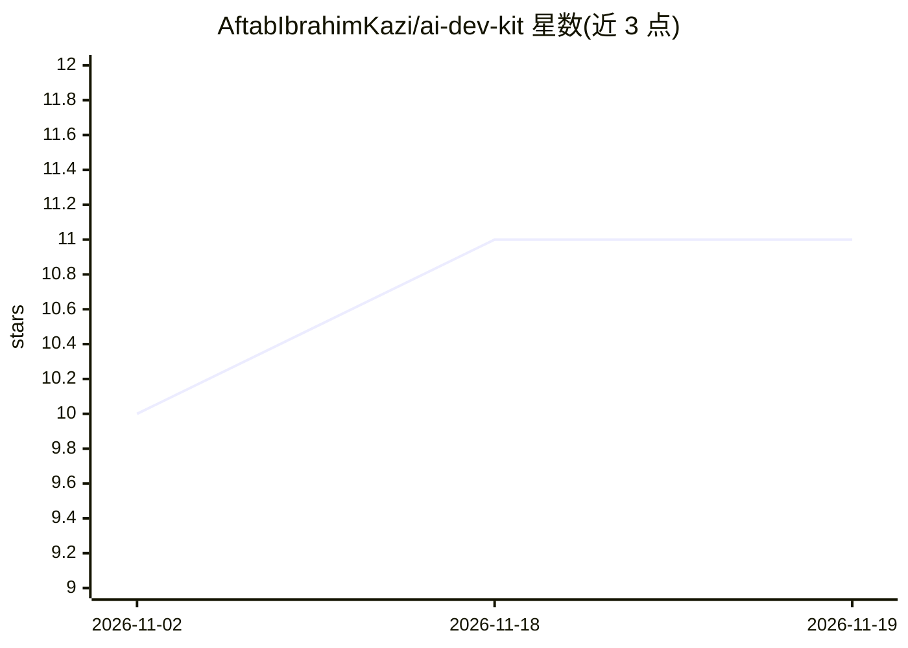

# AftabIbrahimKazi/ai-dev-kit

⭐ 11 · JavaScript · MIT · 推送 2026-11-16 · [GitHub](https://github.com/AftabIbrahimKazi/ai-dev-kit) · [官网](https://ai-dev-kit-docs.vercel.app) · 个人维护

**为 AI 编码代理提供 64 个技能、分层规范与可选 MCP 工具的工具包**

MIT 许可的工具包，让读取 markdown 的编码代理（Claude Code、OpenCode、Codex 等）行为一致并减少 token 消耗。内含 64 个 SKILL.md 技能、覆盖 CSS/HTML/JS/TS/无障碍/SEO/性能/Git/QA 的分层编码规范、18 个斜杠命令、14 个在代码中强制执行规则的 mods，以及可选的本地 MCP 服务器（UI 原型、图像读取/生成、文件预过滤）和离线文本转语音附加组件。安装方式为 git clone 后由 Node.js 安装脚本把文件复制进项目，核心安装只复制 markdown 文件，无构建步骤；技能加载由模型判断触发，mods 才是关键门禁的强制机制。

## 筛选速览

| 维度 | 判定 | 备注 |
|---|---|---|
| AI 角色 | `ai-ecosystem` | LLM/agent 周边工具 |
| 许可风险 | `permissive` | MIT |
| 部署形态 | `desktop` | 安装包/桌面程序 |
| 模型依赖 | local-ok | 支持本地模型 |
| 硬件要求 | — | 无带数字的原话,不猜 |
| 安装摩擦 | `medium` | 含编译或系统依赖之一 |
| 成熟度 | — | 结构信号不足 |

## 能力要点

- 64 个可复用 SKILL.md 技能（53 个面向 Claude Code，11 个面向 OpenCode）
- code-audit 全项目违规计数并精确定位到行
- 可选的免费/本地 MCP 服务器：UI 原型、图像读取/生成、文件预过滤
- 支持 Claude Code / OpenCode / Codex / 纯终端 / CLI 标志五种安装交互方式

## 适用场景

- 让多个 AI 编码会话遵循同一套项目编码规范
- 对旧代码或共享代码做全项目违规审计
- 为项目装配本地图像生成/读取等 MCP 工具

## 场景标签

`编码 Agent` · 领域:编码与开发

## 证据(README 行号)

> L5: **AI Dev Kit** is a free, MIT-licensed toolkit that makes AI coding agents behave consistently and spend fewer token
> L67: 3. Choose **everything**, **pick**, **auto-detect** (scans the project and cites the signal before pinning anything

## 星数曲线

2026-11-02 10 → 2026-11-19 11（+1）

---
*卡片 v1 · prompt 1.4 · 生成 2026-11-19 · 置信度 low · 依据 README sha `48e6aadea91f` · [字段定义](../../DATASET.md)*
