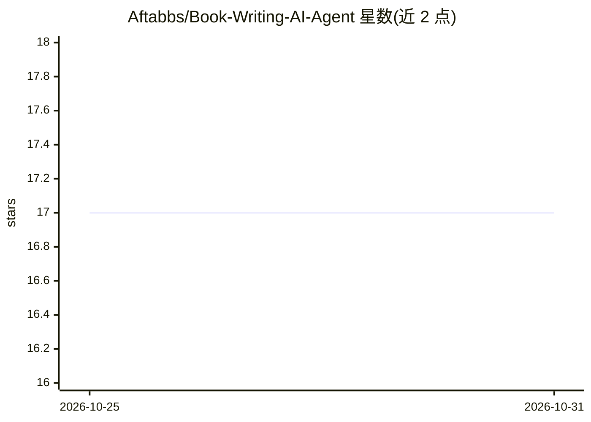

# Aftabbs/Book-Writing-AI-Agent

⭐ 17 · Jupyter Notebook · MIT · 推送 2025-11-04 · [GitHub](https://github.com/Aftabbs/Book-Writing-AI-Agent) · 个人维护

**多智能体自主成书系统：规划、写作、编辑、核查、发布**

基于 CrewAI 框架与 Groq LLaMA-3-70B 的多智能体图书写作流水线：规划智能体生成故事大纲与角色设定，写作智能体按计划逐章撰写（每章 1000+ 词），编辑智能体修订语法与连贯性，事实核查智能体校验真实世界引用，发布智能体输出最终格式化书稿。各智能体按顺序执行，模拟真实出版团队分工。技术栈为 Python、CrewAI、Langchain-Groq，需配置 Groq API 使用。

## 筛选速览

| 维度 | 判定 | 备注 |
|---|---|---|
| AI 角色 | `ai-native` | 本体是模型或模型工具 |
| 许可风险 | `permissive` | MIT |
| 部署形态 | `None` |  |
| 模型依赖 | locked-api |  |
| 硬件要求 | — | 无带数字的原话,不猜 |
| 安装摩擦 | `low` | 无编译、无系统依赖或容器化 |
| 成熟度 | — | 结构信号不足 |

## 能力要点

- 规划/写作/编辑/核查/发布 5 个专职智能体按序协作
- 通过 Langchain-Groq 调用 Groq LLaMA-3-70B 生成内容
- 每章生成 1000+ 词并附带事实核查环节

## 适用场景

- 自动生成完整图书草稿供人工审阅
- 模拟作者-编辑-出版团队流水线创作长文内容
- 体验 CrewAI 多智能体协作编排

## 场景标签

`多智能体` `AI 写作` · 领域:Agent 开发

## 证据(README 行号)

> L3: An intelligent, multi-agent system to autonomously **plan, write, edit, fact-check, and publish** a complete book us
> L7: This project leverages multiple specialized AI agents, each assigned a distinct role in the book creation pipeline:
> L15: All agents work **sequentially** using the `CrewAI` orchestrator to simulate a real-world publishing team.

## 星数曲线

2026-10-25 17 → 2026-10-31 17（+0）

---
*卡片 v1 · prompt 1.4 · 生成 2026-10-30 · 置信度 high · 依据 README sha `de74fbc796ed` · [字段定义](../../DATASET.md)*
