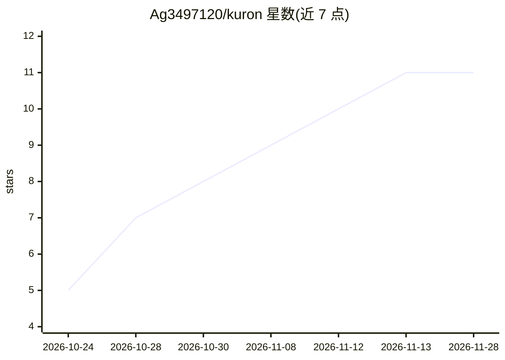

# Ag3497120/kuron

⭐ 11 · JavaScript · MIT · 推送 2026-11-12 · [GitHub](https://github.com/Ag3497120/kuron) · [官网](https://claude.ai/artifact/UMMbf2FcV3ULi6d5WaW1yp) · 个人维护

**让 LLM 扮演整个应用的原型验证工具：先试想法再出构建计划**

kuron 是一个原型验证工具：用户用自然语言写下应用想法，由 LLM 搭建最小界面并实时扮演后端、数据与逻辑，每个按钮操作都由 LLM 作为系统响应，不生成应用代码。验证想法后，工具从系统实际行为逆向生成规格说明、时间表与给编码 agent 的提示词。提供浏览器版（登录 claude.ai 即用）与本地版（npx 运行，支持多种模型后端，Node.js 20+）。作者自述为独立开发的学生，不适合生产使用、像素级 UI 设计与实时场景。

## 筛选速览

| 维度 | 判定 | 备注 |
|---|---|---|
| AI 角色 | `ai-native` | 本体是模型或模型工具 |
| 许可风险 | `permissive` | MIT |
| 部署形态 | `library` | 以包/库形式分发 |
| 模型依赖 | local-ok | 支持本地模型 |
| 硬件要求 | — | 无带数字的原话,不猜 |
| 安装摩擦 | `low` | 无编译、无系统依赖或容器化 |
| 成熟度 | — | 结构信号不足 |

## 能力要点

- LLM 实时扮演后端与业务逻辑，按钮操作即由模型响应
- 多设备共享同一世界状态（平板、PC、手机、看板）
- existing-tech 开关：逐动作估算真实可实现方案与误判率
- 逆向产出规格、黄金示例与带提示词的构建计划

## 适用场景

- 在写代码前用手验证一个产品想法是否可行
- 把验证过的原型转成规格和构建计划交给编码 agent
- 测试尚不存在的技术部件被 LLM 模拟后的体验

## 场景标签

 · 领域:原型/产品验证工具

## 证据(README 行号)

> L3: **Claude acts as the whole app instead of writing it.**
> L32: 2. **Use it.** Claude sets up minimal screens for each device or role, then plays everything that normally takes lo
> L34:  system. No app code is generated.

## 星数曲线

2026-10-24 5 → 2026-11-28 11（+6）

---
*卡片 v1 · prompt 1.4 · 生成 2026-11-19 · 置信度 high · 依据 README sha `ab6ea04287c5` · [字段定义](../../DATASET.md)*
