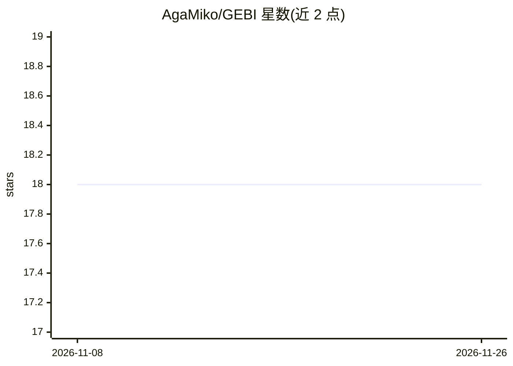

# AgaMiko/GEBI

⭐ 18 · Jupyter Notebook · MIT · 推送 2026-11-03 · [GitHub](https://github.com/AgaMiko/GEBI) · 个人维护

**皮肤病变图像数据集的偏差识别研究代码（注意力图聚类+反事实插入）**

2021 年论文的开源代码与数据：GEBI 框架通过计算图像注意力图、降维（如 Isomap）与谱聚类，把皮肤病变数据集按图像内容与分类器关注区域分组，供领域专家检查黑框、标尺等伪影；再通过向图像插入疑似伪影并对比预测变化来验证偏差。仓库含 8 个 Jupyter notebook 与预处理好的图像及注意力图数据（约 800 MB），训练图像不在仓库内，需自行设置 DATA_DIR。

## 筛选速览

| 维度 | 判定 | 备注 |
|---|---|---|
| AI 角色 | `ai-native` | 本体是模型或模型工具 |
| 许可风险 | `permissive` | MIT |
| 部署形态 | `library` | 以包/库形式分发 |
| 模型依赖 | — | README 未给出锁定关系 |
| 硬件要求 | — | 无带数字的原话,不猜 |
| 安装摩擦 | `low` | 无编译、无系统依赖或容器化 |
| 成熟度 | — | 结构信号不足 |

## 能力要点

- 注意力图+图像联合降维与谱聚类发现数据分组
- 反事实伪影插入（黑框/标尺/红圈）量化预测变化
- 含 SpRay 及其 Isomap 变体用于对比
- 附带 5,000+ 张预处理图像及 Deep Taylor 注意力图

## 适用场景

- 复现论文中的皮肤病变数据集偏差发现实验
- 检查自己图像数据集中的伪影类偏差来源
- 对比研究全局解释方法（GEBI 与 SpRay）

## 场景标签

 · 领域:可解释 AI/医学影像

## 证据(README 行号)

> L7: GEBI finds possible sources of bias in an image dataset. It groups images by both what they show and where the class
> L15: Agnieszka Mikołajczyk, Michał Grochowski, Arkadiusz Kwasigroch

## 星数曲线

2026-11-08 18 → 2026-11-26 18（+0）

---
*卡片 v1 · prompt 1.4 · 生成 2026-11-18 · 置信度 mid · 依据 README sha `d9b4719184a9` · [字段定义](../../DATASET.md)*
