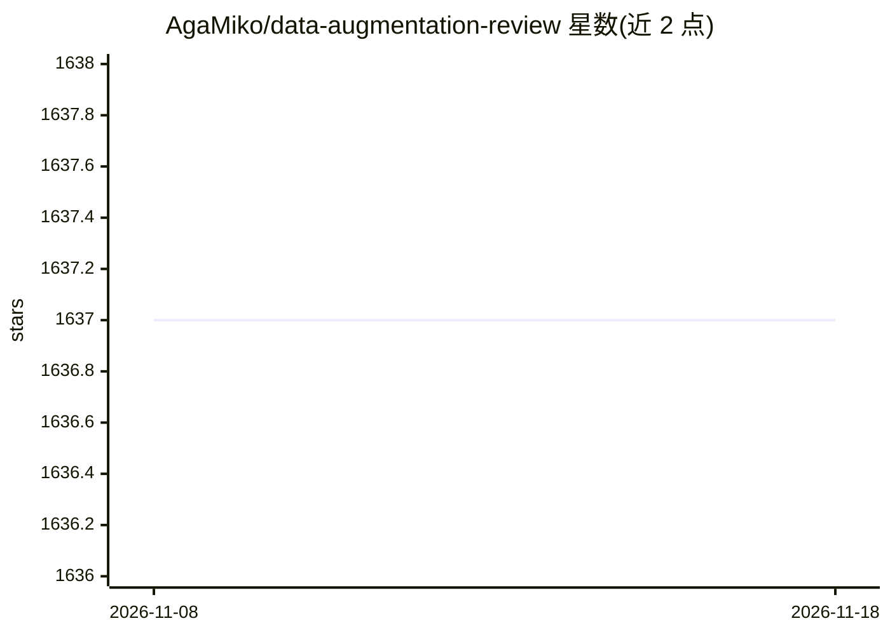

# AgaMiko/data-augmentation-review

⭐ 1,637 · 推送 2026-11-03 · [GitHub](https://github.com/AgaMiko/data-augmentation-review) · 个人维护

**数据增强方法与资源策展清单：覆盖图像/音频/NLP/时序等**

个人维护的数据增强资源聚合清单：按计算机视觉、NLP、大语言模型合成数据、音频、时序、图、表格、3D/视频、基因表达、自动增强等类别整理方法分类、GitHub 仓库、论文（2015–2026）与教程等资源。2026 年 11 月更新扩充了大模型、表格、3D 与视频方向，新增图增强与生成式/扩散增强章节，并标注已归档仓库。作者同时在招募共同维护者。

## 筛选速览

| 维度 | 判定 | 备注 |
|---|---|---|
| AI 角色 | `ai-knowledge` | 知识聚合/清单类 |
| 许可风险 | `none` | — |
| 部署形态 | `None` |  |
| 模型依赖 | — | README 未给出锁定关系 |
| 硬件要求 | — | 无带数字的原话,不猜 |
| 安装摩擦 | `low` | 无编译、无系统依赖或容器化 |
| 成熟度 | — | 结构信号不足 |

## 能力要点

- 按 10+ 数据模态分类整理增强方法
- 收录 2015–2026 年论文与 GitHub 仓库链接
- 已归档仓库标注 *(archived)*，失效链接已修复
- 含 LLM 合成数据与生成式/扩散增强专题章节

## 适用场景

- 为机器学习项目挑选合适的数据增强方法
- 查找特定模态（图像/音频/图/表格）的增强库
- 跟踪 2023–2026 年数据增强方向的论文与仓库

## 场景标签

`精选清单` · 领域:学习与行业

## 证据(README 行号)

> L8: List of useful data augmentation resources. You will find here some links to more or less popular github repos :spar
> L13: * Introduction

## 星数曲线

2026-11-08 1,637 → 2026-11-18 1,637（+0）

---
*卡片 v1 · prompt 1.4 · 生成 2026-11-17 · 置信度 high · 依据 README sha `8d372a6ec9a4` · [字段定义](../../DATASET.md)*
