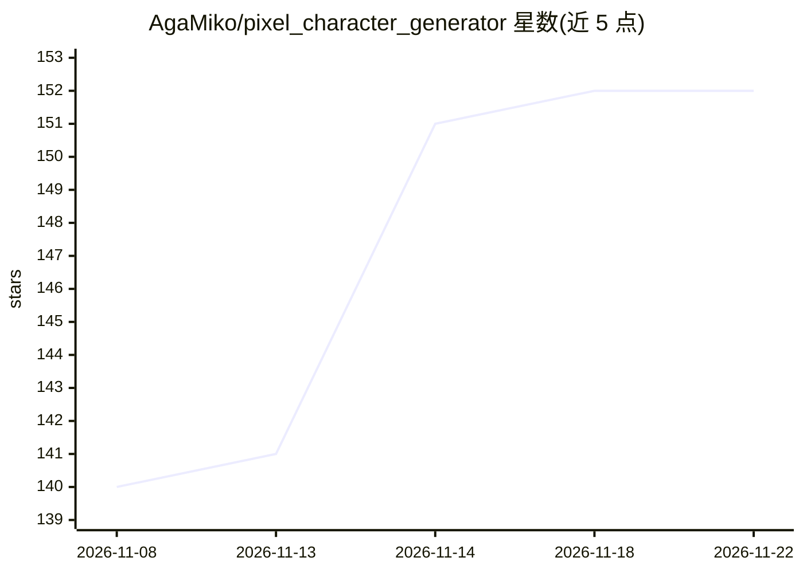

# AgaMiko/pixel_character_generator

⭐ 152 · Jupyter Notebook · 推送 2026-11-03 · [GitHub](https://github.com/AgaMiko/pixel_character_generator) · 个人维护

**用 GAN 与自编码器生成 64×64 复古像素游戏角色，含 TinyHero 数据集**

2020 年项目：随仓库发布 TinyHero 数据集（3648 张 64×64 像素角色，每个角色含随机性别、体型、肤色与装备，分四个视角），并提供 Jupyter notebook 构建数据集和训练四种模型：DCGAN、按指定视角生成的条件 DCGAN、卷积自编码器，以及 GAN 与自编码器组合以去除生成噪声。数据集经 Selenium 调用在线 LPC 生成器采集。模型 notebook 面向 Google Colab GPU 编写，也可本地 pip 安装依赖后用 Jupyter 运行。

## 筛选速览

| 维度 | 判定 | 备注 |
|---|---|---|
| AI 角色 | `ai-native` | 本体是模型或模型工具 |
| 许可风险 | `none` | — |
| 部署形态 | `library` | 以包/库形式分发 |
| 模型依赖 | — | README 未给出锁定关系 |
| 硬件要求 | — | 无带数字的原话,不猜 |
| 安装摩擦 | `low` | 无编译、无系统依赖或容器化 |
| 成熟度 | — | 结构信号不足 |

## 能力要点

- TinyHero 数据集：3648 张 64×64 像素角色、四视角、912 张/类
- 四种模型实现：DCGAN、条件 DCGAN、卷积自编码器、GAN+自编码器组合
- Selenium 驱动在线 LPC 生成器自动构建数据集的 notebook
- notebook 提供 Open in Colab 链接，支持 GPU 训练

## 适用场景

- 生成复古像素风游戏角色素材
- 复用 TinyHero 数据集训练自己的像素角色生成模型
- 学习 DCGAN/条件 GAN/自编码器的实现与训练技巧

## 场景标签

`图像生成` `网页抓取` · 领域:效率与自动化

## 证据(README 行号)

> L3: Generating 64×64 retro pixel game characters with generative adversarial networks (GANs) and autoencoders. The repos
> L41: All models use the convolutional generator and discriminator from the PyTorch DCGAN tutorial, with changes listed b

## 星数曲线

2026-11-08 140 → 2026-11-22 152（+12）

---
*卡片 v1 · prompt 1.4 · 生成 2026-11-17 · 置信度 mid · 依据 README sha `acb667ef41c4` · [字段定义](../../DATASET.md)*
