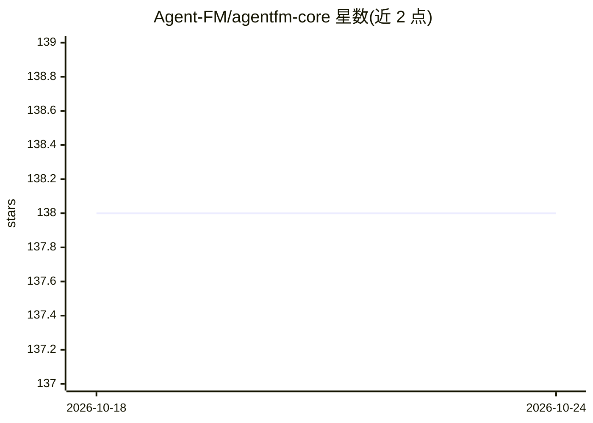

# Agent-FM/agentfm-core

⭐ 138 · JavaScript · Apache-2.0 · 推送 2026-08-14 · [GitHub](https://github.com/Agent-FM/agentfm-core) · [官网](https://agentfm.net) · 组织维护

**将闲置电脑组成 P2P 网格以分发运行 AI agent 的去中心化运行时**

用 Go 与 libp2p 构建的点对点计算网格：把 agent 打包为容器，由 Worker 节点在 Podman 沙箱中运行，Boss 节点（桌面应用/TUI/HTTP 网关）派发任务，Relay 节点负责节点发现与信任账本持久化。提供 OpenAI 兼容 API、Python SDK、基于 Ed25519 签名与 Merkle 日志的去中心化信誉机制。流量端到端加密，无需云账户。桌面应用面向 macOS/Linux（Windows 开发中），安装包当前未签名。

## 筛选速览

| 维度 | 判定 | 备注 |
|---|---|---|
| AI 角色 | `ai-ecosystem` | LLM/agent 周边工具 |
| 许可风险 | `permissive` | Apache-2.0 |
| 部署形态 | `desktop` | 安装包/桌面程序 |
| 模型依赖 | local-ok | 支持本地模型 |
| 硬件要求 | — | 无带数字的原话,不猜 |
| 安装摩擦 | `low` | 无编译、无系统依赖或容器化 |
| 成熟度 | `idea` | |

## 能力要点

- 单二进制多角色：worker/api/boss/relay/witness，用 -mode 切换
- OpenAI 兼容网关，任何 OpenAI SDK 可直接指向本地 mesh
- Worker 每 ~2 秒广播 CPU/GPU/RAM，匹配器路由到低负载节点
- Ed25519 签名评分 + RFC 6962 Merkle 日志 + EigenTrust-lite 信誉，无中心机构

## 适用场景

- 把家里或机房闲置机器组成私有算力网格跑 agent 任务
- 用任何 OpenAI SDK 通过本地网关调用 mesh 上的模型
- 用桌面应用的 Mesh Radar 查看、派发并评价 mesh 上的 agent

## 场景标签

`Agent 框架` `模型网关` · 领域:Agent 开发

## 证据(README 行号)

> L46: - **Worker** — runs your agent in a fresh Podman sandbox (`podman run --rm`) and broadcasts live hardware over a li
> L52: 1. **OpenAI-compatible** — point any OpenAI SDK at your local mesh and it just works.

## 星数曲线

2026-10-18 138 → 2026-10-24 138（+0）

---
*卡片 v1 · prompt 1.4 · 生成 2026-10-23 · 置信度 high · 依据 README sha `e520a663c3ce` · [字段定义](../../DATASET.md)*
