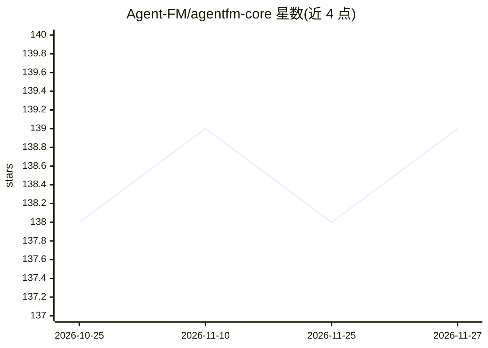

# Agent-FM/agentfm-core

⭐ 139 · JavaScript · Apache-2.0 · 推送 2026-11-22 · [GitHub](https://github.com/Agent-FM/agentfm-core) · [官网](https://agentfm.net) · 组织维护

**把自有闲置机器组成私有 P2P mesh 跑 AI agent 的运行时**

用 Go 编写并附 Electron 桌面应用与 Python SDK：将 agent 打包为容器，在自有 Mac/Linux 机器组成的 P2P mesh 上调度执行。每个 agent 在一次性 Podman 沙箱中运行，网关以 OpenAI wire format 暴露 /v1/chat/completions；节点间通过 libp2p 加密通信，经 mDNS/relay/NAT 穿透发现彼此；信誉基于 Ed25519 签名评分与 Merkle 日志计算。单个二进制提供 worker/api/boss/relay/witness/genkey 六种模式，支持 swarm key 组建私有 swarm。公开 mesh 上执行任务的 worker 可见 prompt，隐私需私有 swarm。

## 筛选速览

| 维度 | 判定 | 备注 |
|---|---|---|
| AI 角色 | `ai-ecosystem` | LLM/agent 周边工具 |
| 许可风险 | `permissive` | Apache-2.0 |
| 部署形态 | `desktop` | 安装包/桌面程序 |
| 模型依赖 | local-ok | 支持本地模型 |
| 硬件要求 | — | 无带数字的原话,不猜 |
| 安装摩擦 | `low` | 无编译、无系统依赖或容器化 |
| 成熟度 | — | 结构信号不足 |

## 能力要点

- OpenAI 兼容网关：改 base_url 即可接入 openai SDK/LangChain/LiteLLM/Open WebUI
- 单二进制六种模式（worker/api/boss/relay/witness/genkey）组成 P2P mesh
- Podman 沙箱运行 agent 容器，任务产物以 zip 回传
- Ed25519 签名评分 + Merkle 日志的信誉与信任门机制

## 适用场景

- 把团队闲置的带 GPU 机器汇总起来跑 agent 任务
- 在自有硬件上运行 agent 而不把 prompt 发给云服务商
- 把几百个 prompt 批量分发到 mesh 中所有可用 worker 执行
- 办公室共享一台运行图像生成 agent 的机器

## 场景标签

`Agent 框架` `模型网关` · 领域:Agent 开发

## 证据(README 行号)

> L21: AgentFM turns those machines into **one mesh**. Install one binary (or the desktop app) on each machine and they fi
> L25: - **Your code already works.** The gateway speaks the OpenAI wire format, so LangChain, LlamaIndex, LiteLLM, Open W
> L147: AgentFM does not replace a model server: a worker usually runs one (Ollama, vLLM) next to its agent.

## 星数曲线

2026-10-25 138 → 2026-11-27 139（+1）

---
*卡片 v1 · prompt 1.4 · 生成 2026-11-27 · 置信度 high · 依据 README sha `4216ac33b56c` · [字段定义](../../DATASET.md)*
