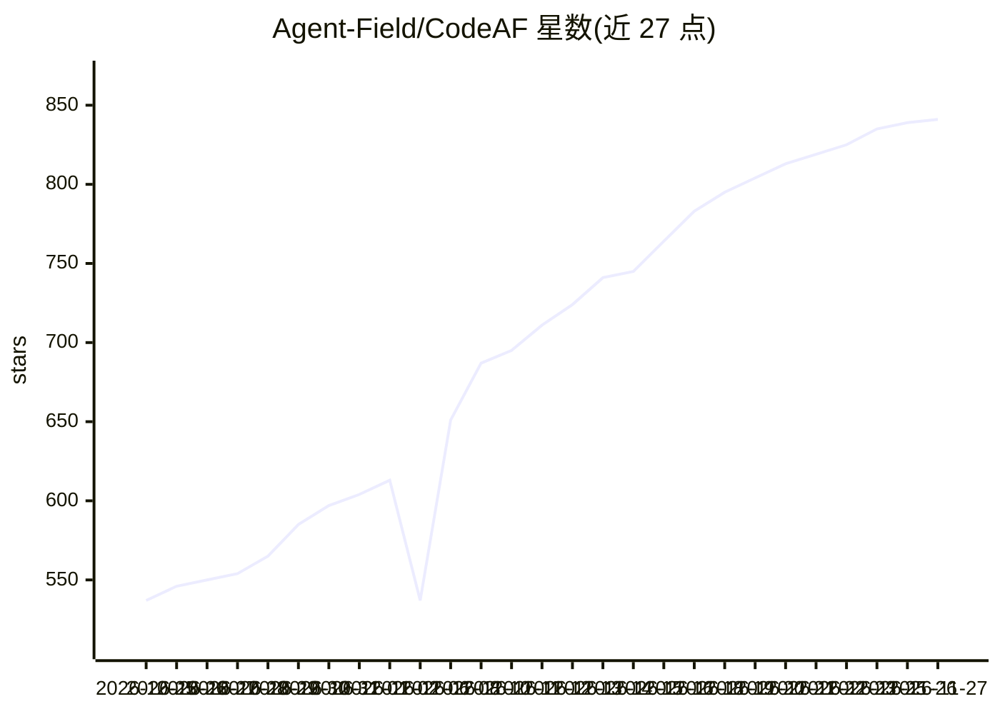

# Agent-Field/CodeAF

⭐ 841 · Go · Apache-2.0 · 推送 2026-11-26 · [GitHub](https://github.com/Agent-Field/CodeAF) · [官网](agentfield.ai/codeaf) · 组织维护

**面向开源模型的多智能体编码工具：单窗口管理多项目编码任务**

用 Go 编写的编码 harness，以单个二进制分发（darwin/linux/windows），面向 DeepSeek、Qwen、GLM、Kimi 等开源模型。核心机制：一个窗口管理机器上所有项目的对话与任务，对话可拆成任务树，每个任务在仓库私有副本的独立分支上运行，通过检查后自动落到用户分支；每个任务由 worker/planner/checker 三席模型组执行，按各 provider 的表现自动选型，并设有花费上限。含 senior-dev、sec、review 三个内置子 harness，支持 headless 模式用于 CI/cron。README 自称处于 early preview 阶段。

## 筛选速览

| 维度 | 判定 | 备注 |
|---|---|---|
| AI 角色 | `ai-ecosystem` | LLM/agent 周边工具 |
| 许可风险 | `permissive` | Apache-2.0 |
| 部署形态 | `desktop` | 安装包/桌面程序 |
| 模型依赖 | local-ok | 支持本地模型 |
| 硬件要求 | — | 无带数字的原话,不猜 |
| 安装摩擦 | `low` | 无编译、无系统依赖或容器化 |
| 成熟度 | `idea` | |

## 能力要点

- 单窗口管理多项目：home 列出全部项目、对话、运行状态与花费
- 对话拆解为任务树，各任务在独立分支的仓库副本中运行
- worker/planner/checker 三席模型组，按任务类型自动选模型
- 内置 senior-dev/sec/review 子 harness 与定时自动化任务

## 适用场景

- 同时推进多个仓库的编码任务，只处理需要人工判断的节点
- 用开源模型跑安全审计与 PR 审查
- 在 CI 或脚本中以 headless 方式执行编码指令

## 场景标签

`编码 Agent` `多智能体` `代码审查` · 领域:Agent 开发

## 证据(README 行号)

> L20: CodeAF is a coding harness built for open models, to get the most out of every
> L31: Written in Go as one small binary, with nothing else to install or run. Apache

## 星数曲线

2026-10-25 537 → 2026-11-27 841（+304）

---
*卡片 v1 · prompt 1.4 · 生成 2026-11-26 · 置信度 mid · 依据 README sha `3ac214740985` · [字段定义](../../DATASET.md)*
