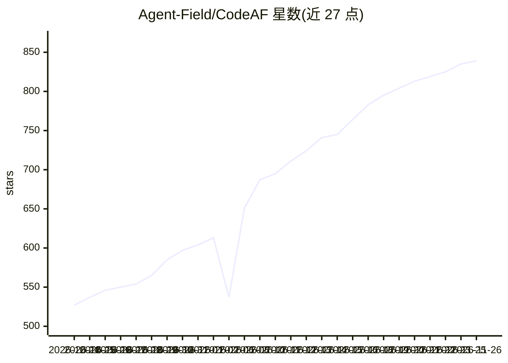

# Agent-Field/CodeAF

⭐ 839 · Go · Apache-2.0 · 推送 2026-11-25 · [GitHub](https://github.com/Agent-Field/CodeAF) · [官网](agentfield.ai/codeaf) · 组织维护

**给开发者的多智能体编码工厂：让开放模型并行处理多项目任务**

用 Go 编写的单二进制编码 harness，面向开放模型（DeepSeek、Qwen、GLM、Kimi、MiniMax、Ollama 等）。单窗口管理多项目对话与任务树：对话可拆为子任务，各在独立仓库副本与分支上运行，通过检查后自动落分支。会话按 worker/planner/checker 三角色分配不同模型，内置 senior-dev、sec、review 三个专项子 harness，支持提醒与定时自动化及 headless JSON 输出。当前为 early preview，平台为 darwin/linux/windows。

## 筛选速览

| 维度 | 判定 | 备注 |
|---|---|---|
| AI 角色 | `ai-ecosystem` | LLM/agent 周边工具 |
| 许可风险 | `permissive` | Apache-2.0 |
| 部署形态 | `desktop` | 安装包/桌面程序 |
| 模型依赖 | local-ok | 支持本地模型 |
| 硬件要求 | — | 无带数字的原话,不猜 |
| 安装摩擦 | `low` | 无编译、无系统依赖或容器化 |
| 成熟度 | `idea` | |

## 能力要点

- 单窗口 home/enter/tab 管理全部项目、对话与花费
- 对话一句话拆成任务树，各任务独立副本与分支，检查通过自动合并
- worker/planner/checker 三模型席位，按任务类型自动选型，可 pin 或限定开放权重模型
- 内置 senior-dev/sec/review 专项子 harness，输出 Markdown/JSON/SARIF 报告

## 适用场景

- 同时推进多个仓库的编码任务，只处理需要人工判断的问题
- 用本地或开放权重模型跑安全审计与 PR 审查
- 在 CI、cron 或脚本中通过 headless 模式执行编码任务

## 场景标签

`编码 Agent` `多智能体` · 领域:Agent 开发

## 证据(README 行号)

> L20: CodeAF is a coding harness built for open models, to get the most out of every
> L31: Written in Go as one small binary, with nothing else to install or run. Apache
> L194: Providers built in: OpenRouter, DeepSeek, GLM, Kimi, MiniMax, Qwen, OpenCode Go,

## 星数曲线

2026-10-24 527 → 2026-11-26 839（+312）

---
*卡片 v1 · prompt 1.4 · 生成 2026-11-25 · 置信度 high · 依据 README sha `a3bf255c6aaa` · [字段定义](../../DATASET.md)*
