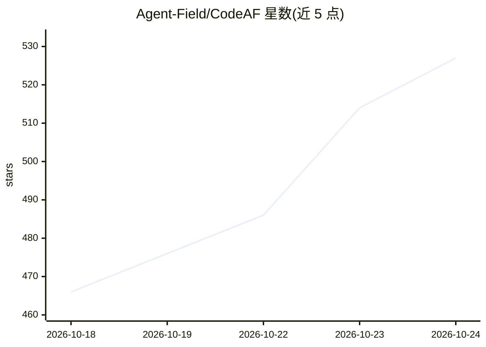

# Agent-Field/CodeAF

⭐ 527 · Go · Apache-2.0 · 推送 2026-10-23 · [GitHub](https://github.com/Agent-Field/CodeAF) · [官网](agentfield.ai/codeaf) · 组织维护

**面向开源模型的终端编码代理“工厂”，统一编排多项目任务**

CodeAF 是用 Go 编写的单二进制编码 harness（coding harness），面向 DeepSeek、Qwen、GLM、Kimi、MiniMax、Ollama 等开放模型及 OpenAI 兼容端点。核心机制：一个窗口管理本机所有项目与对话；一句话可拆分为多个任务，各自在独立分支的仓库副本上运行，通过检查的任务自动合并；内置 senior-dev/sec/review 三个专职 subharness；按任务类型为 worker/planner/checker 席位自动选模（Pareto Crewing），带花费上限；支持 headless 模式（codeaf do 输出 JSON）与远程 devbox 连接。安装为 curl 脚本或源码构建，自称 early preview。

## 筛选速览

| 维度 | 判定 | 备注 |
|---|---|---|
| AI 角色 | `ai-ecosystem` | LLM/agent 周边工具 |
| 许可风险 | `permissive` | Apache-2.0 |
| 部署形态 | `desktop` | 安装包/桌面程序 |
| 模型依赖 | local-ok | 支持本地模型 |
| 硬件要求 | — | 无带数字的原话,不猜 |
| 安装摩擦 | `low` | 无编译、无系统依赖或容器化 |
| 成熟度 | `idea` | |

## 能力要点

- 单窗口管理本机全部项目、对话与任务树，各自独立的审批规则与花费上限
- 一句话拆分为多任务，各自分支运行，通过检查自动合并，绝不直接落 main
- 内置 senior-dev / sec / review 三个 subharness，无需额外安装
- Pareto Crewing 按任务类型为 worker/planner/checker 自动选模，支持花费上限与按日限额

## 适用场景

- 在终端里并行托管多个项目的编码任务并统一审批
- 自动拆分并执行 bug 修复、代码评审、安全审计等重复工作
- 接入 DeepSeek/Ollama 等开放模型控制每任务成本
- CI/脚本中用 headless 模式跑计划型编码任务

## 场景标签

`编码 Agent` `代码审查` `多智能体` · 领域:Agent 开发

## 证据(README 行号)

> L20: CodeAF is a coding harness built for open models, to get the most out of every
> L177: Providers built in: OpenRouter, DeepSeek, GLM, Kimi, MiniMax, Qwen, Codex through a

## 星数曲线

2026-10-18 466 → 2026-10-24 527（+61）

---
*卡片 v1 · prompt 1.4 · 生成 2026-10-21 · 置信度 high · 依据 README sha `fbb3f3583e06` · [字段定义](../../DATASET.md)*
