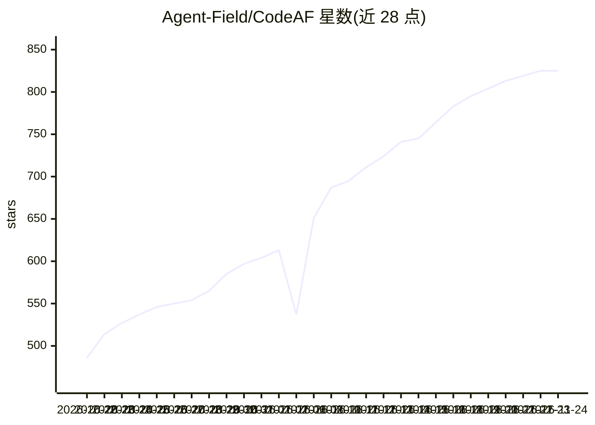

# Agent-Field/CodeAF

⭐ 825 · Go · Apache-2.0 · 推送 2026-11-22 · [GitHub](https://github.com/Agent-Field/CodeAF) · [官网](agentfield.ai/codeaf) · 组织维护

**面向开源模型的编码 agent 工厂：单窗口管理多任务**

Go 编写的单二进制编码 harness，为 DeepSeek、Qwen、GLM、Kimi 等开源模型设计，将对话拆解为任务树，每个任务在独立的仓库副本与分支上运行，通过 planner/checker 角色分工调度多模型并自动合并通过检查的改动。内置 senior-dev、sec、review 等子 harness，支持定时自动化与无界面的 headless 模式（CI/cron/脚本）。首启需连接 OpenRouter 或填入 API key，Ollama 无需密钥。README 自述处于 early preview 阶段。

## 筛选速览

| 维度 | 判定 | 备注 |
|---|---|---|
| AI 角色 | `ai-ecosystem` | LLM/agent 周边工具 |
| 许可风险 | `permissive` | Apache-2.0 |
| 部署形态 | `desktop` | 安装包/桌面程序 |
| 模型依赖 | local-ok | 支持本地模型 |
| 硬件要求 | — | 无带数字的原话,不猜 |
| 安装摩擦 | `low` | 无编译、无系统依赖或容器化 |
| 成熟度 | `idea` | |

## 能力要点

- 单窗口管理多项目、多任务、多会话，任务在独立分支的仓库副本中运行
- 一任务三座席的模型分工：worker/planner/checker，按元数据评分自动选型
- 内置 senior-dev/sec/review 子 harness，支持自定义可复用 harness
- headless 模式：codeaf do/exe/run 供 CI、cron 与脚本调用

## 适用场景

- 同时推进多个项目的编码任务，从一处查看进度与花费
- 用本地开源模型跑自动化代码修改、安全审计与 PR 评审
- 在 CI 或脚本中以 JSON 输出运行无人值守的编码任务

## 场景标签

`编码 Agent` `代码审查` · 领域:编码与开发

## 证据(README 行号)

> L20: CodeAF is a coding harness built for open models, to get the most out of every
> L148: codeaf is built to run many agents at once, not one. A single native Go binary
> L165: One session, many models. The model you talk to is one seat. Every task you hand

## 星数曲线

2026-10-22 486 → 2026-11-24 825（+339）

---
*卡片 v1 · prompt 1.4 · 生成 2026-11-24 · 置信度 high · 依据 README sha `43bfc6ea65b5` · [字段定义](../../DATASET.md)*
