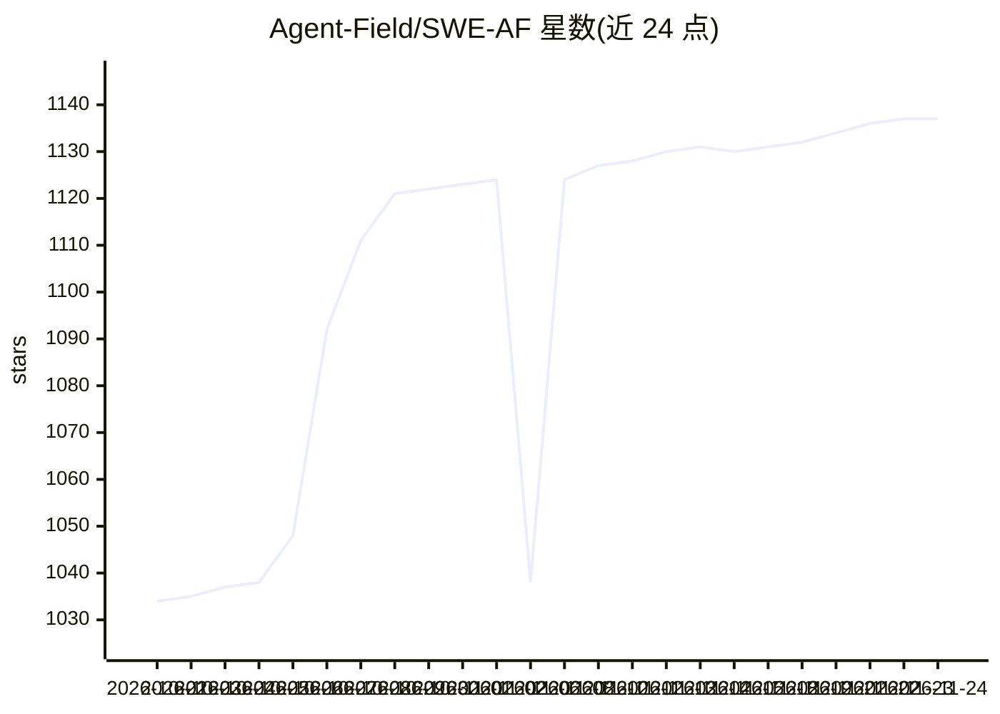

# Agent-Field/SWE-AF

⭐ 1,138 · Go · Apache-2.0 · 推送 2026-11-23 · [GitHub](https://github.com/Agent-Field/SWE-AF) · [官网](https://agentfield.ai/) · 组织维护

**基于 AgentField 的自主软件工程 agent 舰队，一键产出生产级 PR**

SWE-AF 运行于 AgentField 控制平面，通过一次 API 调用启动由产品经理、架构师、编码、审查、测试等角色组成的自主工程团队，对指定仓库做规划、拆解、并行编码、审查、合并与验收。支持单仓库与多仓库两种模式，角色可分配不同模型；内置三层自适应控制循环（重试、重规划）与断点续跑，依赖 git worktree 隔离并行分支。需 Python 3.12+ 与 AgentField CLI，支持 Railway 部署。

## 筛选速览

| 维度 | 判定 | 备注 |
|---|---|---|
| AI 角色 | `ai-native` | 本体是模型或模型工具 |
| 许可风险 | `permissive` | Apache-2.0 |
| 部署形态 | `self-host` | docker 或自建部署 |
| 模型依赖 | locked-api |  |
| 硬件要求 | — | 无带数字的原话,不猜 |
| 安装摩擦 | `low` | 无编译、无系统依赖或容器化 |
| 成熟度 | `idea` | |

## 能力要点

- 一次 API 调用编排规划/编码/审查/QA/合并/验收等多角色 agent
- 单仓库与多仓库（primary/dependency 角色）两种构建模式
- 三层自适应控制循环与 resume_build 断点续跑
- 支持 AForge、Claude Code、OpenCode、Codex、Command Code 等运行时，可按角色配置模型

## 适用场景

- 给一个 GitHub 仓库下达目标，自动拆解并完成多个 issue 到 PR
- 跨主应用与依赖库/微服务的协同改动一次构建
- 本地开发流程中接入 AgentField 控制平面持续运行构建任务

## 场景标签

`多智能体` `编码 Agent` · 领域:Agent 开发

## 证据(README 行号)

> L27: One API call spins up a full autonomous engineering team — product managers, architects, coders, reviewers, testers
> L109: Most agent frameworks wrap a single coder loop. SWE-AF is a coordinated engineering factory — planning, execution,

## 星数曲线

2026-10-21 1,034 → 2026-11-24 1,137（+103）

---
*卡片 v1 · prompt 1.4 · 生成 2026-11-24 · 置信度 mid · 依据 README sha `40bd9192ca40` · [字段定义](../../DATASET.md)*
