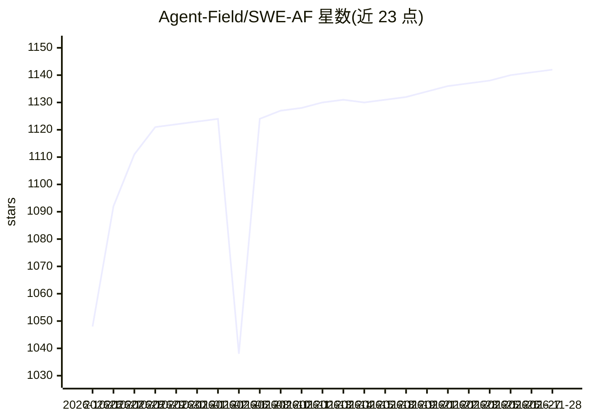

# Agent-Field/SWE-AF

⭐ 1,142 · Go · Apache-2.0 · 推送 2026-11-23 · [GitHub](https://github.com/Agent-Field/SWE-AF) · [官网](https://agentfield.ai/) · 组织维护

**基于 AgentField 的多智能体自主软件工程团队运行时**

SWE-AF 在 AgentField 控制面上编排一组自治 agent（产品经理、架构师、编码、审查、测试、合并、验证），通过一次 API 调用接收目标与仓库地址，拆解 issue、在隔离 git worktree 中并行编码并提交 PR。支持单仓库与多仓库两种模式、按角色配置模型、三级自适应控制循环（重试/换策略/重规划）、检查点续跑。运行依赖 Python 3.12+、AgentField 控制_plane（af CLI）与 LLM provider key，可通过 af install、Railway、源码或 Docker 部署。

## 筛选速览

| 维度 | 判定 | 备注 |
|---|---|---|
| AI 角色 | `ai-native` | 本体是模型或模型工具 |
| 许可风险 | `permissive` | Apache-2.0 |
| 部署形态 | `self-host` | docker 或自建部署 |
| 模型依赖 | locked-api |  |
| 硬件要求 | — | 无带数字的原话,不猜 |
| 安装摩擦 | `low` | 无编译、无系统依赖或容器化 |
| 成熟度 | — | 结构信号不足 |

## 能力要点

- 一次 API 调用编排完整工程团队并产出 PR
- 按角色分配模型，支持 AForge/Claude/OpenCode/Codex/Command Code 运行时
- 三级控制循环：coder 重试、issue advisor、DAG 级重规划
- 检查点执行支持崩溃后 resume_build 续跑

## 适用场景

- 给一个目标仓库自动拆解并实现多个 issue 的修改
- 跨主应用与依赖库的多仓库协同变更
- CI/CD 中以 API 方式触发自动化代码构建

## 场景标签

`多智能体` `编码 Agent` · 领域:Agent 开发

## 证据(README 行号)

> L16: **One API call → full engineering team → shipped code.**
> L27: One API call spins up a full autonomous engineering team — product managers, architects, coders, reviewers, testers
> L109: Most agent frameworks wrap a single coder loop. SWE-AF is a coordinated engineering factory — planning, execution,

## 星数曲线

2026-10-26 1,048 → 2026-11-28 1,142（+94）

---
*卡片 v1 · prompt 1.4 · 生成 2026-11-25 · 置信度 mid · 依据 README sha `92f2ee11c0c8` · [字段定义](../../DATASET.md)*
