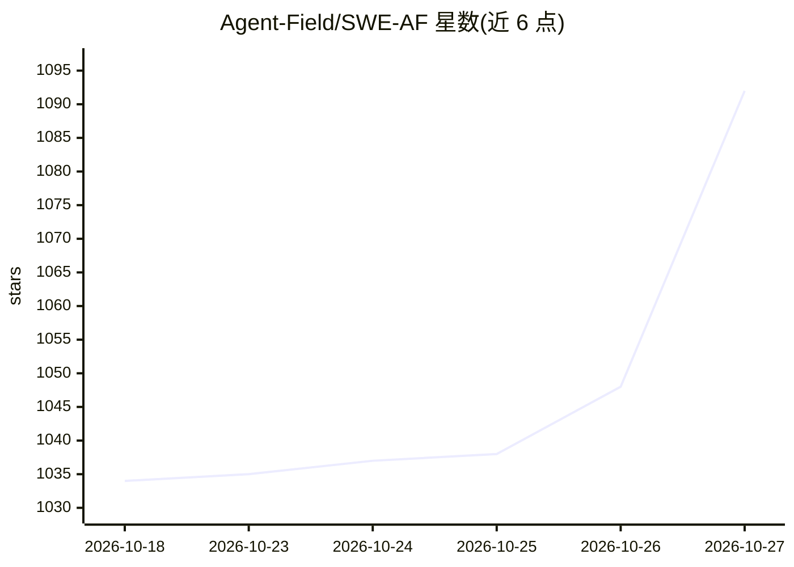

# Agent-Field/SWE-AF

⭐ 1,092 · Go · Apache-2.0 · 推送 2026-10-20 · [GitHub](https://github.com/Agent-Field/SWE-AF) · [官网](https://agentfield.ai/) · 组织维护

**面向生产级 PR 的自主软件工程 agent 舰队运行时**

构建在 AgentField 控制面上的自主工程团队运行时：一次 API 调用拉起产品经理、架构师、编码、评审、测试等角色 agent，对单个或多个仓库进行规划、编码、评审、合并与验证，最终产出 PR。采用三层嵌套控制循环（问题内重试、顾问改策、DAG 级重规划），支持按角色配置不同模型，运行时可选 claude_code / open_code / codex，接入 Anthropic、OpenRouter（含 DeepSeek 默认模型）、MiniMax、Infron 等提供方。部署方式包括 af install、Railway 一键部署、本地 venv 与 Docker。当前标注为 Public Beta。

## 筛选速览

| 维度 | 判定 | 备注 |
|---|---|---|
| AI 角色 | `ai-native` | 本体是模型或模型工具 |
| 许可风险 | `permissive` | Apache-2.0 |
| 部署形态 | `self-host` | docker 或自建部署 |
| 模型依赖 | locked-api |  |
| 硬件要求 | — | 无带数字的原话,不猜 |
| 安装摩擦 | `low` | 无编译、无系统依赖或容器化 |
| 成熟度 | `idea` | |

## 能力要点

- 一次 API 调用编排规划/编码/评审/测试/合并多角色 agent
- 三层自适应控制循环：重试、换策略、DAG 级重规划
- 单仓库与多仓库协同模式，按角色分配不同模型
- 检查点执行支持 resume_build 崩溃恢复

## 适用场景

- 给一个目标让 agent 舰队在仓库上自主完成并提交 PR
- 跨主仓库与依赖库的协同变更构建
- 以多节点并行方式持续驱动大规模 agent 构建

## 场景标签

`编码 Agent` `多智能体` · 领域:Agent 开发

## 证据(README 行号)

> L27: One API call spins up a full autonomous engineering team — product managers, architects, coders, reviewers, testers
> L113: - **Multi-model, multi-provider** — assign different models per role (`coder: opus`, `qa: haiku`). Works with Clau
> L150: **Claude, open-source, and Codex models supported**: Run builds with any runtime and tune models per role in one f

## 星数曲线

2026-10-18 1,034 → 2026-10-27 1,092（+58）

---
*卡片 v1 · prompt 1.4 · 生成 2026-10-21 · 置信度 mid · 依据 README sha `d31ee31dcaaf` · [字段定义](../../DATASET.md)*
