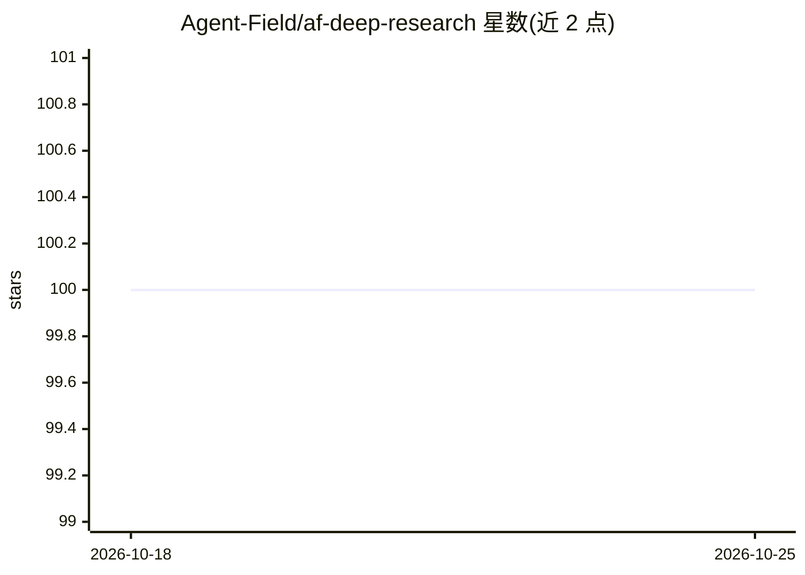

# Agent-Field/af-deep-research

⭐ 100 · Python · Apache-2.0 · 推送 2026-06-01 · [GitHub](https://github.com/Agent-Field/af-deep-research) · [官网](https://agentfield.ai/) · 组织维护

**自主深度研究后端 API：多代理并行检索并产出结构化研究报告**

构建在 AgentField 运行时之上的研究 API 后端（非聊天界面）：提交一个查询后，系统并行派生多个代理流，对检索结果做哈希去重、语义去重与相关性过滤，进行跨流综合与缺口分析，未达质量阈值则生成子查询继续循环，单次研究约编排 10,000 次逻辑代理调用。输出包含类型化实体、关系边、带出处的证据与带引用的层级文档，通过 REST API/SSE/Webhook 集成，可 Docker 部署或本地 Python 运行，支持 Ollama 本地模型与离线场景。README 声明处于早期预览阶段，API 可能变更。

## 筛选速览

| 维度 | 判定 | 备注 |
|---|---|---|
| AI 角色 | `ai-native` | 本体是模型或模型工具 |
| 许可风险 | `permissive` | Apache-2.0 |
| 部署形态 | `self-host` | docker 或自建部署 |
| 模型依赖 | local-ok | 支持本地模型 |
| 硬件要求 | — | 无带数字的原话,不猜 |
| 安装摩擦 | `low` | 无编译、无系统依赖或容器化 |
| 成熟度 | `idea` | |

## 能力要点

- 扇出→过滤→综合→缺口分析→再扇出的自纠错研究循环
- 输出结构化 JSON：类型化实体、关系边、带出处证据与引用文档
- research_focus/research_scope/tension_lens/source_strictness 等研究参数
- 支持 Ollama 本地模型与自托管，无遥测

## 适用场景

- 为应用接入自动深度研究能力（投资尽调、竞争情报）
- 从研究输出构建知识图谱入图数据库
- 合规场景下生成带来源追踪的审计型研究报告

## 场景标签

`多智能体` `知识图谱` `科研工具` · 领域:Agent 开发

## 证据(README 行号)

> L11: A research API that questions itself. Submit a query. The system spawns parallel agents, evaluates what it found ag
> L94: The API returns a research package with five components:

## 星数曲线

2026-10-18 100 → 2026-10-25 100（+0）

---
*卡片 v1 · prompt 1.4 · 生成 2026-10-23 · 置信度 high · 依据 README sha `239a0385f56a` · [字段定义](../../DATASET.md)*
