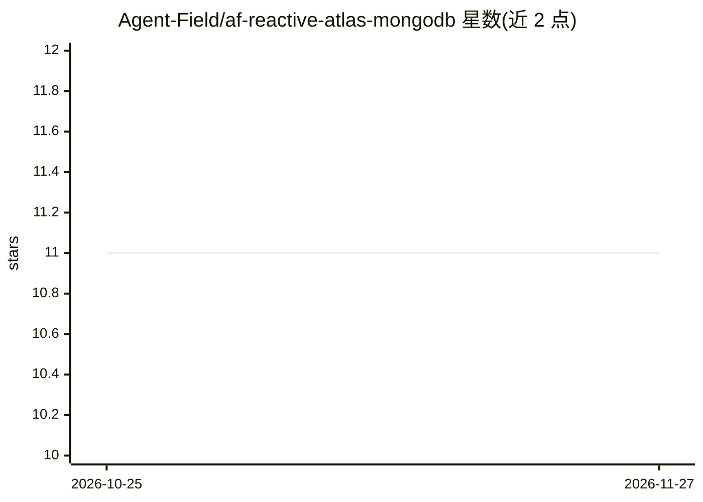

# Agent-Field/af-reactive-atlas-mongodb

⭐ 11 · Python · Apache-2.0 · 推送 2026-06-01 · [GitHub](https://github.com/Agent-Field/af-reactive-atlas-mongodb) · [官网](http://www.agentfield.ai) · 组织维护

**把 MongoDB Atlas 集合变成 AI 智能层的文档富化引擎**

以 Atlas Triggers 监听集合插入并经 HTTPS 调用 AgentField agent，对原始文档执行分诊、深度调查、LLM 推理与策略评估，将带证据链的 `_intelligence` 结果写回原文档，原数据不动。AI 行为全部由 MongoDB 中的配置文档定义（观察集合、上下文加载、级联策略、提示词、规则集合），修改配置即时生效、无需改代码。仓库自带 finance（AML 合规）与 ecommerce（订单欺诈）两个完整示例域，新增域仅需 JSON 配置。依赖 Docker、Python 3.10+、Atlas 账号、OpenRouter API key 与 cloudflared 隧道。

## 筛选速览

| 维度 | 判定 | 备注 |
|---|---|---|
| AI 角色 | `ai-native` | 本体是模型或模型工具 |
| 许可风险 | `permissive` | Apache-2.0 |
| 部署形态 | `self-host` | docker 或自建部署 |
| 模型依赖 | locked-api |  |
| 硬件要求 | — | 无带数字的原话,不猜 |
| 安装摩擦 | `low` | 无编译、无系统依赖或容器化 |
| 成熟度 | — | 结构信号不足 |

## 能力要点

- Atlas Triggers 原生变更检测驱动，无需轮询/外部队列
- 全部 AI 行为由单个 MongoDB 配置文档定义，零代码切换域
- 富化结果带证据链写回 `_intelligence` 字段，可索引可查询
- 级联机制：风险超阈值时更新关联实体并触发网络级分析

## 适用场景

- 对交易集合做 AML 合规检测并保留审计轨迹
- 对电商订单做欺诈信号识别与关联单据重分析
- 为患者分诊、内容审核、安全事件等新文档域快速搭建富化流程

## 场景标签

`工作流自动化` · 领域:效率与自动化

## 证据(README 行号)

> L5: Atlas Triggers detect changes. AgentField adds the reasoning. Documents arrive raw and leave enriched — risk scores,
> L65: - **AgentField** runs the reasoning agent. It loads a domain config from MongoDB that tells it which collection to 
> L74: 5. **LLM reasoning** — the domain-specific prompt, full context, triage signals, and rule set produce a structured 

## 星数曲线

2026-10-25 11 → 2026-11-27 11（+0）

---
*卡片 v1 · prompt 1.4 · 生成 2026-11-19 · 置信度 high · 依据 README sha `489a00121ece` · [字段定义](../../DATASET.md)*
