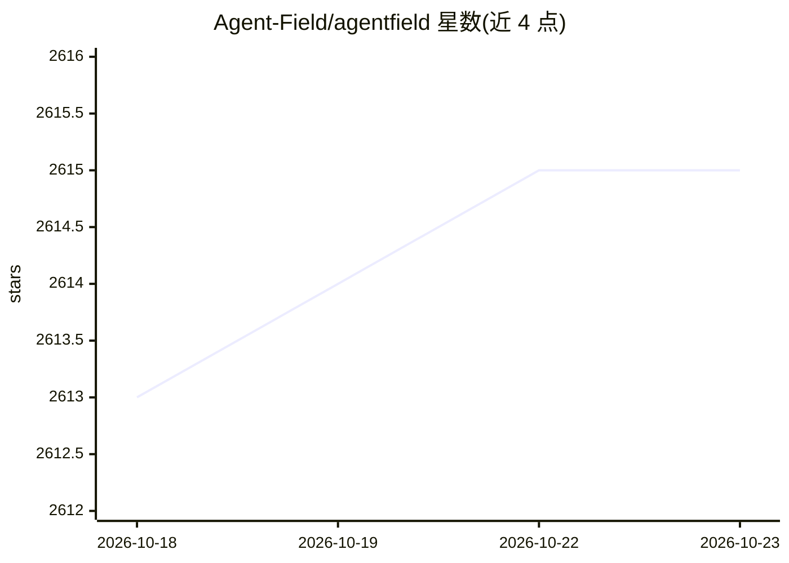

# Agent-Field/agentfield

⭐ 2,615 · Go · Apache-2.0 · 推送 2026-10-22 · [GitHub](https://github.com/Agent-Field/agentfield) · [官网](http://www.agentfield.ai) · 组织维护

**给开发者的 AI agent 控制平面：像 API 一样构建与运行 agent**

开源控制平面，把 Python/Go/TypeScript 写的 agent 函数转为 REST 端点，由控制平面负责路由、队列、重试、追踪与跨 agent 调用，可从单机扩展到数千 agent 的 fan-out 工作流。功能含结构化 LLM 输出（LiteLLM 支持 100+ 模型）、分布式 KV+向量记忆、异步执行（webhook/SSE、无超时限制）、人工审批暂停、金丝雀发布，以及基于 W3C DID 的 agent 加密身份与可验证凭证审计。可通过 install.sh 安装并配合 Claude Code 等 coding agent 用一条 prompt 生成 Docker Compose 栈；控制平面为无状态 Go 服务。

## 筛选速览

| 维度 | 判定 | 备注 |
|---|---|---|
| AI 角色 | `ai-ecosystem` | LLM/agent 周边工具 |
| 许可风险 | `permissive` | Apache-2.0 |
| 部署形态 | `self-host` | docker 或自建部署 |
| 模型依赖 | — | README 未给出锁定关系 |
| 硬件要求 | — | 无带数字的原话,不猜 |
| 安装摩擦 | `low` | 无编译、无系统依赖或容器化 |
| 成熟度 | — | 结构信号不足 |

## 能力要点

- agent 函数自动暴露为 REST 端点，控制平面处理 fan-out、队列与重试
- app.ai() 经 LiteLLM 支持 100+ LLM，输出 Pydantic/Zod 结构化结果
- W3C DID 加密身份、可离线验证的执行凭证与策略门控
- 分布式 KV+向量记忆（四种 scope）、异步执行（webhook/SSE）与人工审批暂停

## 适用场景

- 把 agent 变成可被其他服务调用的生产级 API
- 用一个 prompt 在 coding agent 中生成多 agent 后端并容器化部署
- 给多 agent 工作流加身份认证、审计与策略控制

## 场景标签

`多智能体` `Agent 框架` · 领域:Agent 开发

## 证据(README 行号)

> L20: AgentField is an open-source control plane that lets you build AI agents callable by any service in your stack - fr

## 星数曲线

2026-10-18 2,613 → 2026-10-23 2,615（+2）

---
*卡片 v1 · prompt 1.4 · 生成 2026-10-21 · 置信度 mid · 依据 README sha `17896e71a470` · [字段定义](../../DATASET.md)*
