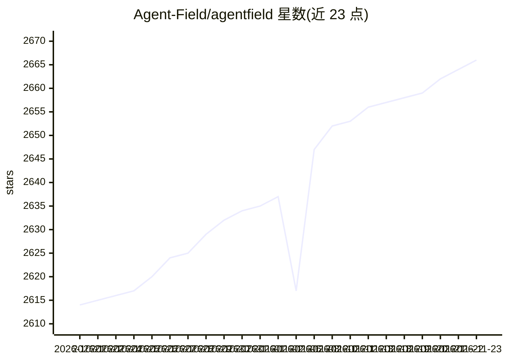

# Agent-Field/agentfield

⭐ 2,666 · Go · Apache-2.0 · 推送 2026-11-22 · [GitHub](https://github.com/Agent-Field/agentfield) · [官网](http://www.agentfield.ai) · 组织维护

**把 AI 代理像 API 一样构建、运行与扩展的后端控制面**

开源（Apache 2.0）的 AI 代理控制面：用 Python/Go/TypeScript 编写的代理函数自动暴露为 REST 端点，控制面负责路由、异步执行、队列、重试、跨代理调用与可观测性。提供四作用域内存、W3C DID 代理身份、基于标签的策略门控与签名审计轨迹，支持金丝雀发布、人工审批暂停与 Prometheus 指标。可通过 curl 安装脚本、Docker Compose 或 Kubernetes 部署，附 Dashboard、Python/Go/TypeScript SDK 与 REST API。

## 筛选速览

| 维度 | 判定 | 备注 |
|---|---|---|
| AI 角色 | `ai-ecosystem` | LLM/agent 周边工具 |
| 许可风险 | `permissive` | Apache-2.0 |
| 部署形态 | `self-host` | docker 或自建部署 |
| 模型依赖 | locked-api |  |
| 硬件要求 | — | 无带数字的原话,不猜 |
| 安装摩擦 | `low` | 无编译、无系统依赖或容器化 |
| 成熟度 | — | 结构信号不足 |

## 能力要点

- 每个函数自动暴露为 REST 端点，控制面处理扇出、队列与重试
- 代理获得 W3C DID 加密身份与签名审计轨迹，策略由基础设施执行
- 四作用域内存（global/actor/session/workflow）含 KV 与向量检索，无需 Redis
- Harness 编排 CodeAF/Claude Code/Codex/Gemini CLI 等多轮编码代理

## 适用场景

- 把内部代理以 REST API 形式提供给前后端或其他服务调用
- 一个请求扇出到上千代理分支并追踪每条执行路径
- 需要人工审批、审计轨迹与访问控制的代理生产部署
- 跨语言团队用 Python/Go/TypeScript 编写代理并统一治理

## 场景标签

`编码 Agent` `LLM 可观测性` `Agent 框架` · 领域:Agent 开发

## 证据(README 行号)

> L21: AgentField is an open-source control plane that lets you build AI agents callable by any service in your stack - fr
> L117: Most agent tools help you **write** agent logic. AgentField is what **runs** it in production: the layer that make
> L141: AgentField is an open-source (Apache 2.0) framework and control plane: you write agents in it and they run as back

## 星数曲线

2026-10-21 2,614 → 2026-11-23 2,666（+52）

---
*卡片 v1 · prompt 1.4 · 生成 2026-11-23 · 置信度 mid · 依据 README sha `bc663e48afbb` · [字段定义](../../DATASET.md)*
