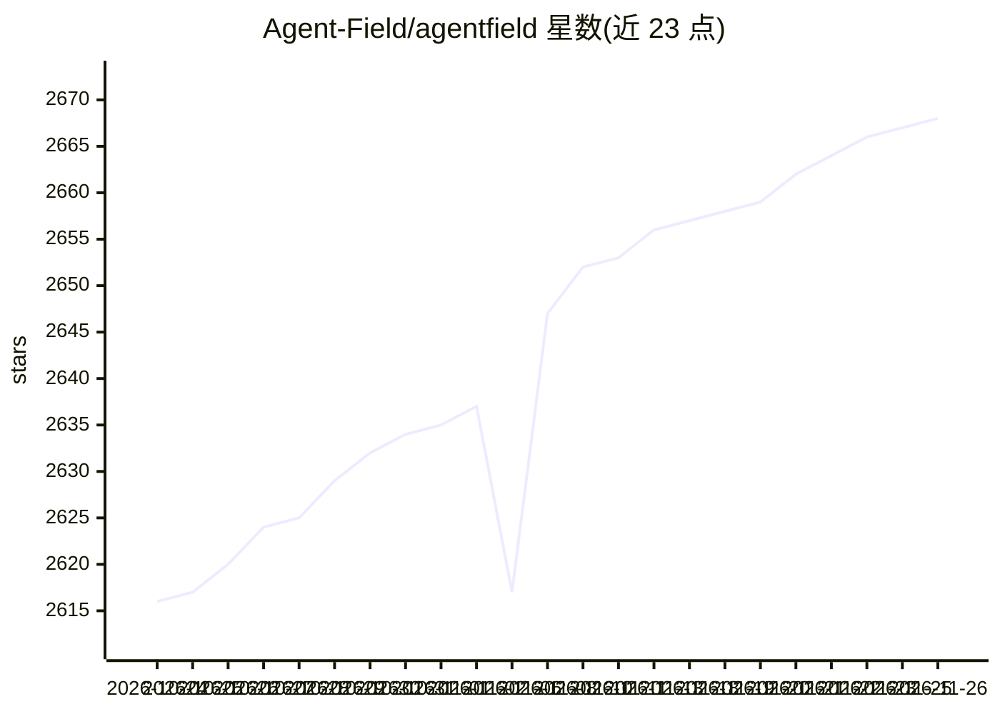

# Agent-Field/agentfield

⭐ 2,668 · Go · Apache-2.0 · 推送 2026-11-23 · [GitHub](https://github.com/Agent-Field/agentfield) · [官网](http://www.agentfield.ai) · 组织维护

**开发者构建运行扩展 AI 代理的开源控制平面**

AgentField 是一个 Apache 2.0 的开源控制平面，把用 Python、Go 或 TypeScript 编写的 agent 函数转换为可被其他服务调用的 REST 端点，提供路由、异步执行、重试、内存（KV+向量检索四作用域）、服务发现与可观测性（工作流 DAG、Prometheus 指标）。控制平面为无状态 Go 服务，可水平扩展；每个 agent 获得基于 W3C DID 的加密身份与签名审计轨迹。提供 Python/Go/TypeScript SDK、REST API、Dashboard、安装脚本及 Docker Compose、Kubernetes 部署方式。

## 筛选速览

| 维度 | 判定 | 备注 |
|---|---|---|
| AI 角色 | `ai-ecosystem` | LLM/agent 周边工具 |
| 许可风险 | `permissive` | Apache-2.0 |
| 部署形态 | `self-host` | docker 或自建部署 |
| 模型依赖 | — | README 未给出锁定关系 |
| 硬件要求 | — | 无带数字的原话,不猜 |
| 安装摩擦 | `low` | 无编译、无系统依赖或容器化 |
| 成熟度 | — | 结构信号不足 |

## 能力要点

- 每个函数自动暴露为 REST 端点，跨 agent 调用经控制平面路由
- 异步执行支持 webhooks/SSE 与重试，单次运行可达数小时或数天
- 基于 W3C DID 的 agent 加密身份、策略门控与可离线验证的审计凭证
- 支持金丝雀发布、人工审批暂停与多语言 SDK

## 适用场景

- 把内部 agent 以 API 形式暴露给前端/后端/定时任务调用
- 一个请求扇出到数千个 agent 分支的场景编排
- 企业需要对 agent 执行做身份、策略与审计治理
- 通过 /agentfield 规格在编码代理中生成多 agent 后端

## 场景标签

`LLM 可观测性` `Agent 框架` · 领域:Agent 开发

## 证据(README 行号)

> L21: AgentField is an open-source control plane that lets you build AI agents callable by any service in your stack - fr
> L145: AgentField is an open-source (Apache 2.0) framework and control plane: you write agents in it and they run as back

## 星数曲线

2026-10-24 2,616 → 2026-11-26 2,668（+52）

---
*卡片 v1 · prompt 1.4 · 生成 2026-11-24 · 置信度 high · 依据 README sha `a280abf7661e` · [字段定义](../../DATASET.md)*
