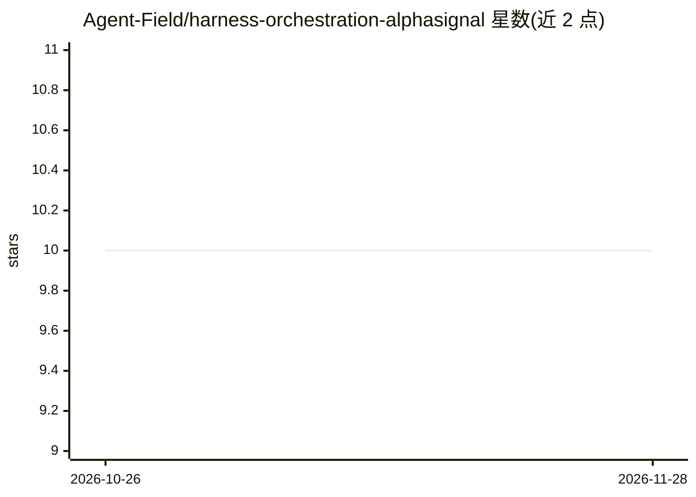

# Agent-Field/harness-orchestration-alphasignal

⭐ 10 · Jupyter Notebook · 推送 2026-08-20 · [GitHub](https://github.com/Agent-Field/harness-orchestration-alphasignal) · 个人维护

**面向开发者的 agent harness 编排教程：7+ 笔记本从单次调用到运行时自生成执行图**

AlphaSignal 演讲配套教学仓库，基于 AgentField 构建，以 Jupyter 笔记本章节组织（00 bootstrap 到 08 度量），逐步引入 typed reasoner、@app.reasoner、reasoner 间调用、AgentRouter+asyncio DAG、元提示生成子图、运行时 fan-out 与 headless 运行。示例域为事件分诊根因定位，附 12 个带因果标注的事故、26 维分类法与可证明的 ground truth。要求 Python 3.13，模型走 OpenRouter；笔记本连同输出一起提交，可只读不装。

## 筛选速览

| 维度 | 判定 | 备注 |
|---|---|---|
| AI 角色 | `ai-knowledge` | 知识聚合/清单类 |
| 许可风险 | `none` | — |
| 部署形态 | `None` |  |
| 模型依赖 | locked-api |  |
| 硬件要求 | — | 无带数字的原话,不猜 |
| 安装摩擦 | `low` | 无编译、无系统依赖或容器化 |
| 成熟度 | — | 结构信号不足 |

## 能力要点

- 7+ 个章节笔记本从单次 LLM 调用渐进到运行时自生成执行图
- 提供 'blast radius' 度量机制，量化指令委托后的失控范围
- 12 个带植入根因的事故数据集与 26 维 lens 分类法，支持可证明的评估
- 笔记本连同输出提交，无需安装即可阅读

## 适用场景

- 学习用 AgentField 构建多 agent 编排系统
- 研究运行时动态生成执行图的做法
- 在事件分诊场景实验 agent 系统的可靠性度量

## 场景标签

`教程课程` · 领域:学习与行业

## 证据(README 行号)

> L11: Material accompanying the AlphaSignal talk on harness orchestration. Built on
> L37: Each adds one rung of autonomy and one AgentField primitive. Every notebook opens with

## 星数曲线

2026-10-26 10 → 2026-11-28 10（+0）

---
*卡片 v1 · prompt 1.4 · 生成 2026-11-20 · 置信度 high · 依据 README sha `168989032b38` · [字段定义](../../DATASET.md)*
