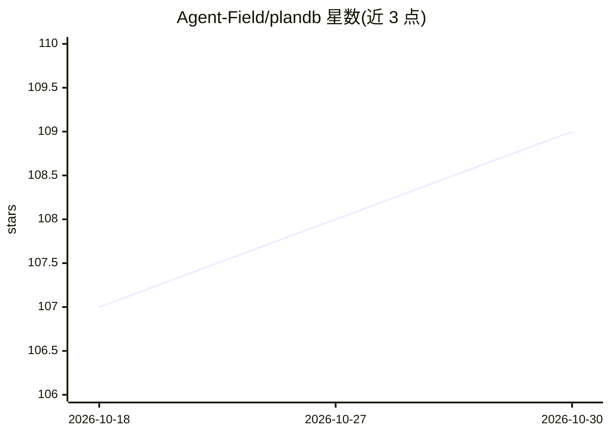

# Agent-Field/plandb

⭐ 109 · Rust · Apache-2.0 · 推送 2026-09-24 · [GitHub](https://github.com/Agent-Field/plandb) · [官网](https://agentfield.ai/) · 组织维护

**面向 AI agent 的本地优先任务/问题跟踪器（单二进制+SQLite）**

为 AI 编程 agent 提供的任务规划与协调工具：以复合图（任意深度子任务包含关系 + 跨边界依赖边）组织任务，支持运行中 split/insert/pivot 调整计划；`plandb go` 用原子操作做多 agent 任务认领，提供关键路径与瓶颈分析、前后置条件、BM25 全文检索（任务/上下文/笔记）、YAML 导入导出与终端实时面板。本地优先，单二进制、SQLite 存储，无需云或账号。三种接口：CLI、MCP server、HTTP API。安装脚本可自动为 Claude Code、Cursor、Codex、Gemini CLI 等框架写入规则文件。

## 筛选速览

| 维度 | 判定 | 备注 |
|---|---|---|
| AI 角色 | `ai-ecosystem` | LLM/agent 周边工具 |
| 许可风险 | `permissive` | Apache-2.0 |
| 部署形态 | `None` |  |
| 模型依赖 | — | README 未给出锁定关系 |
| 硬件要求 | — | 无带数字的原话,不猜 |
| 安装摩擦 | `low` | 无编译、无系统依赖或容器化 |
| 成熟度 | — | 结构信号不足 |

## 能力要点

- 复合图任务模型：任意深度子任务 + 跨边界依赖，依赖自动重连
- 原子多 agent 任务认领（plandb go），避免重复工作
- CLI / MCP server / HTTP API 三种接口
- BM25 检索覆盖任务、上下文、笔记；上下文经认领自动浮现

## 适用场景

- 多 agent 并行开发时分配与认领任务、避免重复劳动
- 让编程 agent 在会话间持久化计划、发现与决策
- 用关键路径/瓶颈分析决定下一步工作重点

## 场景标签

`多智能体` `Agent 记忆` · 领域:Agent 开发

## 证据(README 行号)

> L83: - **Three interfaces.** CLI for shell agents. MCP server for Claude Code / Cursor / Windsurf. HTTP API for custom a
> L164: PlanDB is the task planning layer for **AgentField** — the open-source AI backend for building and running AI agen

## 星数曲线

2026-10-18 107 → 2026-10-30 109（+2）

---
*卡片 v1 · prompt 1.4 · 生成 2026-10-23 · 置信度 high · 依据 README sha `34a15cbcdfa7` · [字段定义](../../DATASET.md)*
