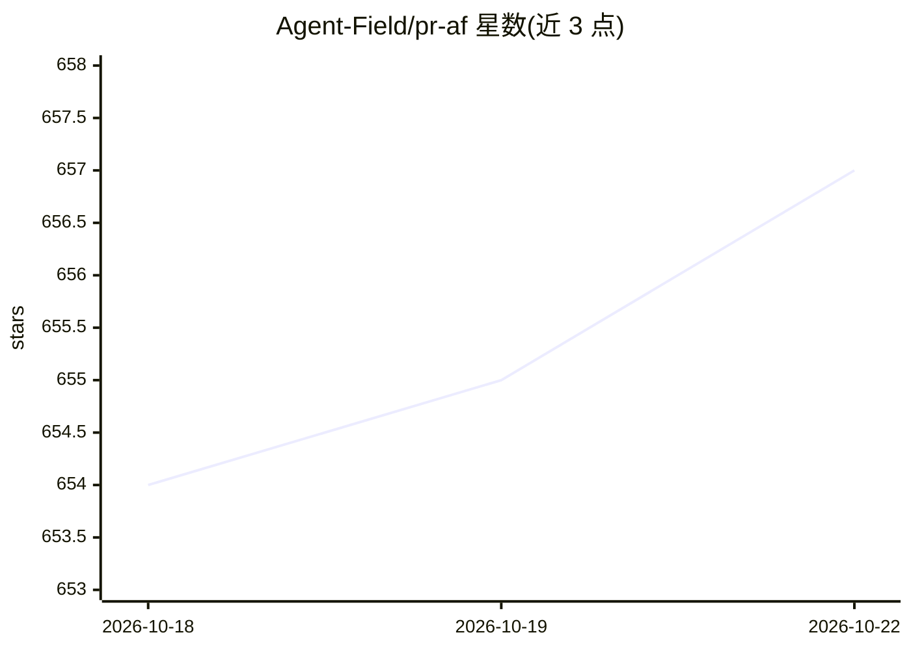

# Agent-Field/pr-af

⭐ 657 · Go · 推送 2026-09-21 · [GitHub](https://github.com/Agent-Field/pr-af) · [官网](https://www.agentfield.ai) · 组织维护

**面向 CI/CD 的开源 Agentic 代码审查工具，基于 AgentField**

PR-AF 是构建在 AgentField 控制平面上的开源 agentic 代码审查节点：将每个 PR 转为任务专属审查计划，动态派生多个专职审查 agent，对发现做代码证据落地与可证伪校验后，以行内评论形式发布到 GitHub。通过 OpenRouter 路由模型，可用低成本模型跑常规 PR、更强模型跑高风险 PR；单次审查典型耗时 35-50 分钟，含成本与时长上限配置。提供 af install、Railway 一键部署、Docker Compose 本地运行与 GitHub Actions 集成四种方式。

## 筛选速览

| 维度 | 判定 | 备注 |
|---|---|---|
| AI 角色 | `ai-native` | 本体是模型或模型工具 |
| 许可风险 | `none` | — |
| 部署形态 | `self-host` | docker 或自建部署 |
| 模型依赖 | locked-api |  |
| 硬件要求 | — | 无带数字的原话,不猜 |
| 安装摩擦 | `low` | 无编译、无系统依赖或容器化 |
| 成熟度 | — | 结构信号不足 |

## 能力要点

- 动态编译审查维度并派生临时专职 reviewer agent 的多阶段流水线
- 发现须通过证据落地（Evidence Grounding）与可证伪门（Falsifiability Gates）才输出
- 经 OpenRouter 按需选择模型，支持成本/时长上限等环境变量配置
- 提供 af install、Railway 部署、Docker Compose 与 GitHub Actions 集成

## 适用场景

- 在 CI/CD 中对 PR 做深度架构级审查门禁
- 以行内评论形式在 GitHub PR 上发布带证据的发现
- 按风险级别切换不同成本的模型执行审查

## 场景标签

`代码审查` · 领域:编码与开发

## 证据(README 行号)

> L17: PR-AF is the **#1 open-source code reviewer on Martian Code-Review-Bench**. It is built
> L19: review plan, spawn focused reviewer agents, ground findings in code evidence, challenge
> L129: af run pr-af

## 星数曲线

2026-10-18 654 → 2026-10-22 657（+3）

---
*卡片 v1 · prompt 1.4 · 生成 2026-10-21 · 置信度 high · 依据 README sha `b7e6b2dd23af` · [字段定义](../../DATASET.md)*
