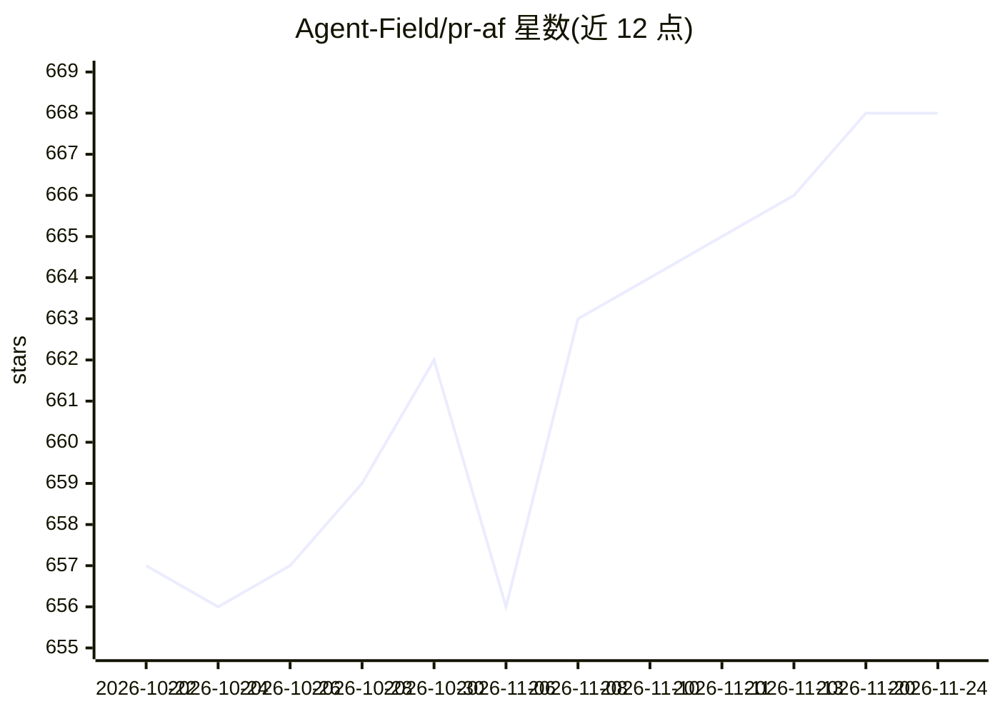

# Agent-Field/pr-af

⭐ 668 · Go · 推送 2026-11-13 · [GitHub](https://github.com/Agent-Field/pr-af) · [官网](https://www.agentfield.ai) · 组织维护

**基于 AgentField 的开源 PR 代码审查 agent，供 CI 使用**

PR-AF 是构建在 AgentField 控制平面之上的 agentic 代码审查节点：将每个 Pull Request 编译为任务化审查计划，生成专门的临时 reviewer agent，按 7 阶段自适应流水线执行，含证据溯源（拉取调用方代码片段验证发现）、跨文件复合风险合成、可证伪性门控等机制，最终在 GitHub 上发布带 file/line/evidence 的评论。面向需要 CI/CD 深度审查门禁的团队，通过 af CLI、curl、Railway、Docker Compose 或 GitHub Actions 触发，单次审查约 35-50 分钟。

## 筛选速览

| 维度 | 判定 | 备注 |
|---|---|---|
| AI 角色 | `ai-native` | 本体是模型或模型工具 |
| 许可风险 | `none` | — |
| 部署形态 | `self-host` | docker 或自建部署 |
| 模型依赖 | locked-api |  |
| 硬件要求 | — | 无带数字的原话,不猜 |
| 安装摩擦 | `low` | 无编译、无系统依赖或容器化 |
| 成熟度 | — | 结构信号不足 |

## 能力要点

- 7 阶段自适应流水线：按 PR 拓扑动态生成审查维度与临时 reviewer agent
- 证据溯源与可证伪性门控：发现需通过代码级验证才发布为评论
- 模型可分级：常规 PR 用低成本模型，重要 PR 换 GLM-5.2 或 Opus 级模型
- 支持 CLI/curl/CI/Railway/GitHub Actions 多种触发方式

## 适用场景

- 作为 GitHub Actions 的 PR 审查门禁，打标签即自动触发
- 自托管代码审查 API，供 CI 或其他 agent 调用
- 在合并前做跨文件的复合风险与架构级审查

## 场景标签

`代码审查` · 领域:编码与开发

## 证据(README 行号)

> L18: for deep code review, not shallow diff summaries: turn each PR into a task-specific
> L40: |**Self-hosted API**|Run locally with Docker; trigger reviews by CLI, curl, CI, or other agents.|
> L78: When a PR arrives, the system dynamically compiles review dimensions — evaluating the diff through semantic, mechan

## 星数曲线

2026-10-22 657 → 2026-11-24 668（+11）

---
*卡片 v1 · prompt 1.4 · 生成 2026-11-24 · 置信度 high · 依据 README sha `bf57aa6891de` · [字段定义](../../DATASET.md)*
