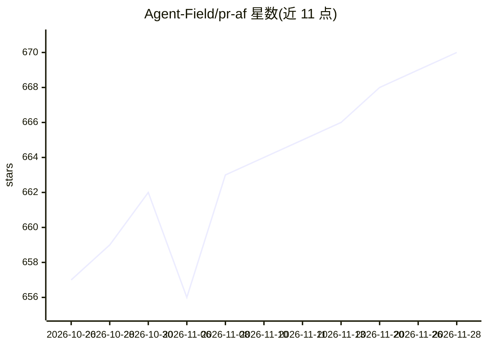

# Agent-Field/pr-af

⭐ 670 · Go · 推送 2026-11-23 · [GitHub](https://github.com/Agent-Field/pr-af) · [官网](https://www.agentfield.ai) · 组织维护

**基于 AgentField 的开源 PR 代码审查 Agent，供 CI/CD 深度审查**

PR-AF 是构建在 AgentField 控制平面上的 agentic 代码审查节点：接收 PR URL 后动态生成审查计划，按语义/机械/系统维度生成临时审查 agent，通过证据定位、复合风险聚合与可证伪门控筛选发现，最终以 GitHub 内联评论形式输出带文件、行号与证据的审查结果。支持 af CLI、curl HTTP API、Railway 一键部署与 Docker Compose 本地运行，模型经 OpenRouter 路由，可选 DeepSeek/GLM/Opus 级模型。单次审查通常需 35-50 分钟，定位为 CI/CD 门禁用途。

## 筛选速览

| 维度 | 判定 | 备注 |
|---|---|---|
| AI 角色 | `ai-native` | 本体是模型或模型工具 |
| 许可风险 | `none` | — |
| 部署形态 | `self-host` | docker 或自建部署 |
| 模型依赖 | locked-api |  |
| 硬件要求 | — | 无带数字的原话,不猜 |
| 安装摩擦 | `low` | 无编译、无系统依赖或容器化 |
| 成熟度 | — | 结构信号不足 |

## 能力要点

- 动态流水线：按 PR 拓扑生成专用临时审查 agent（7 阶段自适应管线）
- 证据定位与可证伪门控：发现须附带代码证据并通过反证检验
- GitHub Actions 集成：加 pr-af 标签即触发，无需额外配置
- 模型分级调用：常规 PR 用低成本模型，高风险审查用前沿模型

## 适用场景

- 在 CI/CD 中对 PR 做深度架构级审查门禁
- 自托管 API 后通过 CLI/curl 触发 PR 审查
- 希望以开源模型跑可复现代码审查流程的团队

## 场景标签

`代码审查` `编码 Agent` · 领域:编码与开发

## 证据(README 行号)

> L17: PR-AF is the **#1 open-source code reviewer on Martian Code-Review-Bench**. It is built
> L76: PR-AF does not execute a static script. It structurally morphs its own execution graph based on the topology of the
> L104: Before a finding becomes a GitHub comment, the system tries to invalidate it: safe behavior, intended behavior, ex

## 星数曲线

2026-10-26 657 → 2026-11-28 670（+13）

---
*卡片 v1 · prompt 1.4 · 生成 2026-11-25 · 置信度 high · 依据 README sha `84703dc931d2` · [字段定义](../../DATASET.md)*
