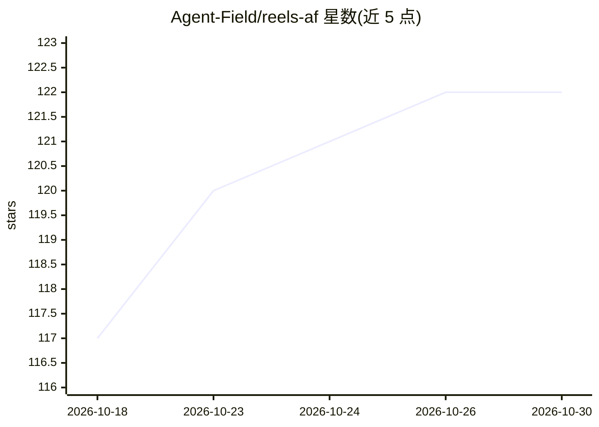

# Agent-Field/reels-af

⭐ 122 · Python · Apache-2.0 · 推送 2026-06-05 · [GitHub](https://github.com/Agent-Field/reels-af) · 组织维护

**面向内容创作者的 AI 多智能体短视频生成器：URL/主题→竖版 reel**

基于 AgentField 运行时的多智能体管线：输入文章 URL 或主题短语，经 18 个专职 reasoner（4 hunter → critic → 3 narrator → judge 级联）生成 Hook→Mechanism→Payoff 脚本，用 Gemini 3.1 Flash TTS 合成音频、Gemini 2.5 Flash Image 生成每拍首帧，ffmpeg 拼接输出 1080×1920、20-25 秒的 H.264+AAC 竖版视频，附带逐词卡拉OK字幕与 result.json。模型经 OpenRouter 调用，约 80-110 秒、约 $0.08-0.10 一条；开 Veo 3.1 Lite i2v 约 $1.20。推理模型可通过环境变量切到自托管 OpenAI 兼容端点，但媒体生成仍走 OpenRouter。以 Docker compose 或 uv CLI 运行。

## 筛选速览

| 维度 | 判定 | 备注 |
|---|---|---|
| AI 角色 | `ai-native` | 本体是模型或模型工具 |
| 许可风险 | `permissive` | Apache-2.0 |
| 部署形态 | `self-host` | docker 或自建部署 |
| 模型依赖 | locked-api |  |
| 硬件要求 | — | 无带数字的原话,不猜 |
| 安装摩擦 | `low` | 无编译、无系统依赖或容器化 |
| 成熟度 | — | 结构信号不足 |

## 能力要点

- URL/主题两种入口，18 reasoner DAG 级联选题与写稿
- Gemini TTS 逐句合成 + Gemini Flash Image 首帧 + ffmpeg 单次拼接成 1080×1920 reel
- 默认 ken-burns 动画零额外成本，可选 Veo 3.1 Lite i2v
- 推理模型可用任一 OpenRouter 模型或自托管 OpenAI 兼容端点替换

## 适用场景

- 把文章或主题一键转成可发布的竖版短视频
- 低成本批量产出 TikTok/Reels 内容
- 通过 AgentField 控制面观察多智能体 DAG 执行过程

## 场景标签

`多智能体` `视频生成` · 领域:Agent 开发

## 证据(README 行号)

> L18: Article URL or topic phrase → 1080×1920 vertical reel with word-burst karaoke, in about 80 seconds at **≈$0.10 per 
> L43: Other pipelines fight TTS sync drift, over-pause and kill retention, generate literal-but-boring visuals, or front-
> L95: |**Runtime**|AgentField|Async-parallel reasoner orchestration. 18 reasoners per reel; depth-3 DAG (4 hunters → crit

## 星数曲线

2026-10-18 117 → 2026-10-30 122（+5）

---
*卡片 v1 · prompt 1.4 · 生成 2026-10-23 · 置信度 high · 依据 README sha `e2ddd3ab6343` · [字段定义](../../DATASET.md)*
