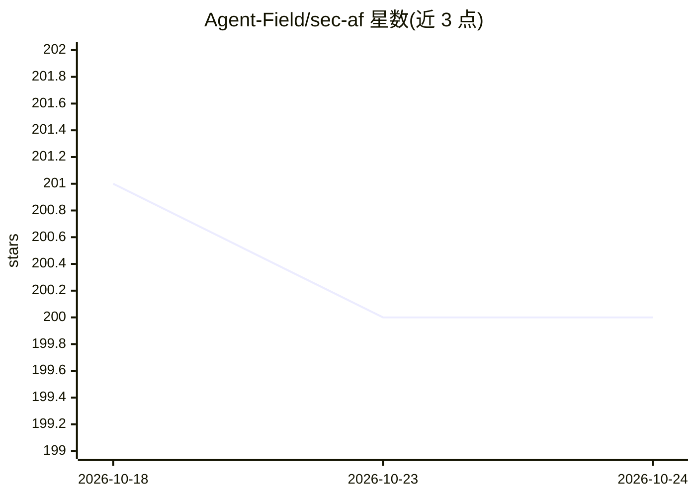

# Agent-Field/sec-af

⭐ 200 · Go · Apache-2.0 · 推送 2026-08-21 · [GitHub](https://github.com/Agent-Field/sec-af) · [官网](https://agentfield.ai/) · 组织维护

**面向开发者的 AI 代码安全审计工具：证明漏洞可利用性**

SEC-AF 是构建在 AgentField 编排框架上的 AI-native 静态代码安全审计服务（SAST），输入仓库 URL，输出带判定结论（confirmed/likely/inconclusive/not_exploitable）、完整污点追踪与证据位置的安全发现。核心机制是 RECON→HUNT→DEDUP→PROVE→REMEDIATION 五阶段流水线，约 200-300 个分工的 LLM agent 组成 reasoner DAG，PROVE 阶段用 4 个对抗性子代理尝试反驳每个发现，DVGA 基准上报称 94% 噪声削减。限制：不覆盖 GraphQL 协议层/运行时（DAST）攻击；单次审计需约 78 分钟与 LLM API 费用。通过 af CLI 或 HTTP API 调用。

## 筛选速览

| 维度 | 判定 | 备注 |
|---|---|---|
| AI 角色 | `ai-native` | 本体是模型或模型工具 |
| 许可风险 | `permissive` | Apache-2.0 |
| 部署形态 | `self-host` | docker 或自建部署 |
| 模型依赖 | — | README 未给出锁定关系 |
| 硬件要求 | — | 无带数字的原话,不猜 |
| 安装摩擦 | `low` | 无编译、无系统依赖或容器化 |
| 成熟度 | — | 结构信号不足 |

## 能力要点

- 每个发现附判定结论、污点追踪与可执行证据
- HUNT/PROVE 对抗验证：4 个子代理（追踪/净化分析/利用假设/裁决）
- RECON→HUNT→DEDUP→PROVE→REMEDIATION 流水线，约 200-300 个 agent 调用
- AI gate 按技术栈动态路由狩猎策略与 CWE 扩展

## 适用场景

- 对代码仓库做带可利用性证明的 SAST 审计
- 降低扫描误报：通过对抗验证过滤不可利用的发现
- 为确认/很可能的漏洞获取修复建议

## 场景标签

`网络安全` `代码审查` · 领域:编码与开发

## 证据(README 行号)

> L18: Other tools flag patterns. SEC-AF **proves exploitability**: every finding ships with a verdict, a data flow trace,
> L49: Every finding includes a **verdict** (`confirmed` / `likely` / `inconclusive` / `not_exploitable`), a **proof objec
> L119: The 9 missed scenarios are primarily **GraphQL protocol-level attacks**: batch queries, deep recursion, alias abus

## 星数曲线

2026-10-18 201 → 2026-10-24 200（-1）

---
*卡片 v1 · prompt 1.4 · 生成 2026-10-23 · 置信度 mid · 依据 README sha `9d059bfe1cdd` · [字段定义](../../DATASET.md)*
