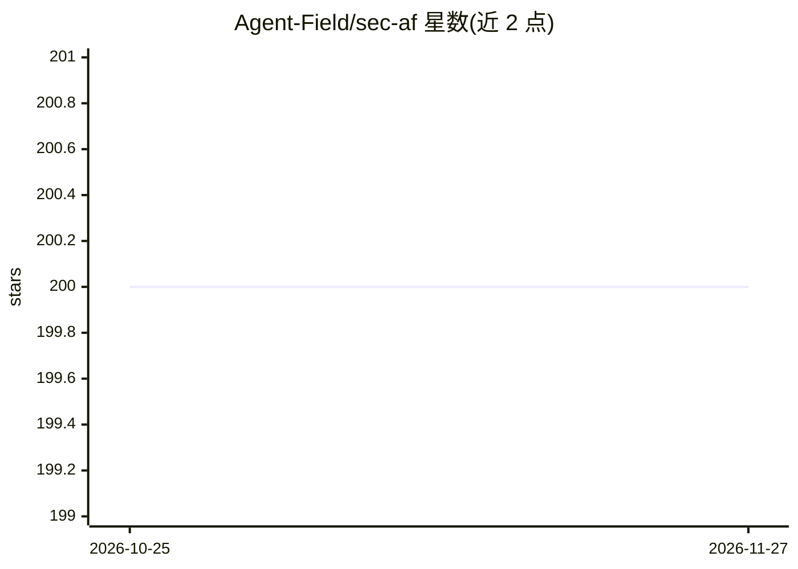

# Agent-Field/sec-af

⭐ 200 · Go · Apache-2.0 · 推送 2026-11-12 · [GitHub](https://github.com/Agent-Field/sec-af) · [官网](https://agentfield.ai/) · 组织维护

**给开发者用的 AI 代码安全审计器，输出可利用性判定与证据链**

基于 AgentField 构建的 SAST 审计工具，对给定仓库执行 RECON→HUNT→DEDUP→PROVE→REMEDIATION 流水线，约 200-300 个聚焦 agent 组成 reasoner DAG。每个发现附带 confirmed/likely/inconclusive/not_exploitable 判定、完整污点追踪与代码位置，经 4-agent 对抗验证链过滤误报（DVGA 基准：106 条原始发现收敛为 28 条确认）。通过 af CLI（≥0.1.87）或 HTTP API 单调用触发，按 LLM 调用计费。当前仅支持静态分析，GraphQL 协议层攻击检测在路线图中。

## 筛选速览

| 维度 | 判定 | 备注 |
|---|---|---|
| AI 角色 | `ai-native` | 本体是模型或模型工具 |
| 许可风险 | `permissive` | Apache-2.0 |
| 部署形态 | `self-host` | docker 或自建部署 |
| 模型依赖 | — | README 未给出锁定关系 |
| 硬件要求 | — | 无带数字的原话,不猜 |
| 安装摩擦 | `low` | 无编译、无系统依赖或容器化 |
| 成熟度 | — | 结构信号不足 |

## 能力要点

- 每个发现附带可利用性判定、污点追踪与代码位置
- HUNT/PROVE 对抗式 agent 架构，4-agent 验证链
- AI 门控动态路由：按检测到的技术栈选择 hunt 策略与 CWE 目标
- AgentField 控制面提供完整 DAG 可观测性

## 适用场景

- 审计仓库中 SQL 注入、命令注入、认证绕过等漏洞并获取可利用性证据
- 对安全扫描结果做去重与对抗验证，降低误报噪音
- 为已确认漏洞生成修复建议
- 评估依赖漏洞是否存在可利用调用路径

## 场景标签

`代码审查` · 领域:编码与开发

## 证据(README 行号)

> L18: Other tools flag patterns. SEC-AF **proves exploitability**: every finding ships with a verdict, a data flow trace,
> L49: Every finding includes a **verdict** (`confirmed` / `likely` / `inconclusive` / `not_exploitable`), a **proof objec
> L91: Most AI security tools ask a single model "is this vulnerable?" and accept the answer. SEC-AF structurally separate

## 星数曲线

2026-10-25 200 → 2026-11-27 200（+0）

---
*卡片 v1 · prompt 1.4 · 生成 2026-11-25 · 置信度 high · 依据 README sha `12a602a92101` · [字段定义](../../DATASET.md)*
