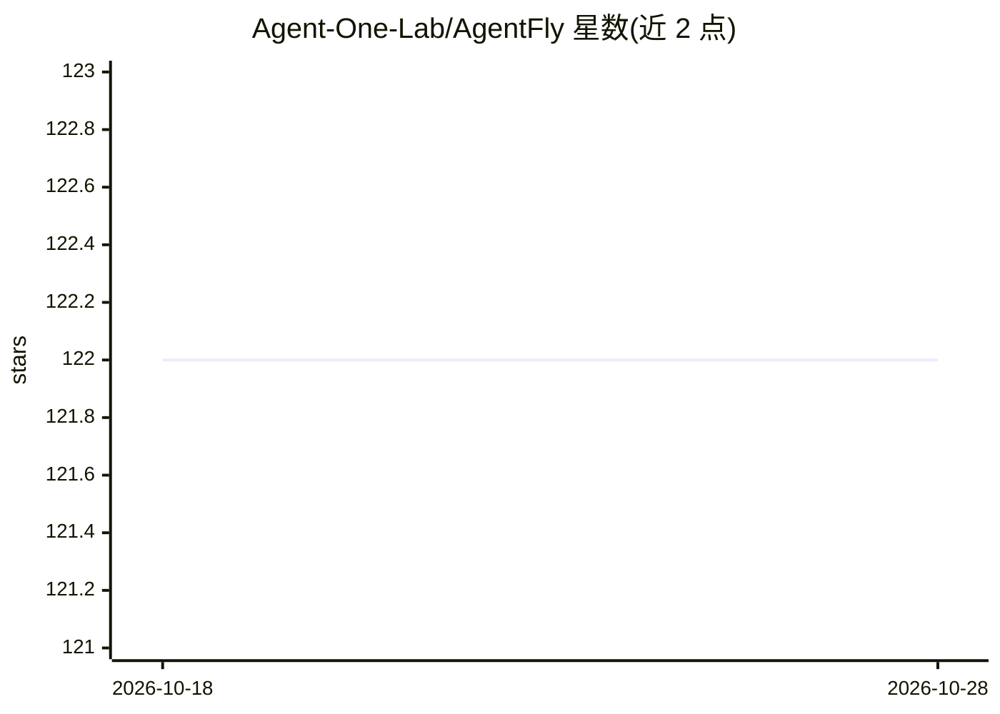

# Agent-One-Lab/AgentFly

⭐ 122 · Python · Apache-2.0 · 推送 2026-10-27 · [GitHub](https://github.com/Agent-One-Lab/AgentFly) · 组织维护 · 中文 README

**用强化学习训练 LLM agent 的可扩展框架（多轮、多模态）**

面向研究者的 LLM agent 强化学习训练框架：基于 verl 做多轮训练（token 级掩码），支持 GRPO、Reinforce++ 等算法的多链 rollout；以装饰器 @tool / @reward 定义工具与奖励函数，异步执行工具调用与奖励计算以提升吞吐，并内置集中式资源系统管理环境与容器。支持视觉语言 agent 训练，提供 SearchR1、WebShop、ScienceWorld、SWE、SimuScene 等预置任务与训练脚本。一键安装假设 conda + Python 3.12，训练假设 8 GPU 计算节点。

## 筛选速览

| 维度 | 判定 | 备注 |
|---|---|---|
| AI 角色 | `ai-ecosystem` | LLM/agent 周边工具 |
| 许可风险 | `permissive` | Apache-2.0 |
| 部署形态 | `None` |  |
| 模型依赖 | — | README 未给出锁定关系 |
| 硬件要求 | — | 无带数字的原话,不猜 |
| 安装摩擦 | `low` | 无编译、无系统依赖或容器化 |
| 成熟度 | — | 结构信号不足 |

## 能力要点

- 基于 verl 的多轮 RL 训练，token 级掩码支持 GRPO/Reinforce++
- @tool / @reward 装饰器定义工具与奖励函数
- 异步工具调用与集中式资源管理系统支持高吞吐训练
- 支持视觉语言（多模态）agent 训练与多模型 chat template

## 适用场景

- 为 LLM agent 设计多轮强化学习训练流程
- 复现或扩展 SearchR1、WebShop、SWE 等任务的训练
- 自定义工具、奖励函数与 agent 类，搭建自己的 RL 环境

## 场景标签

`强化学习` `多模态` `Agent 框架` · 领域:Agent 开发

## 证据(README 行号)

> L31: AgentFly is an extensible framework for building LLM agents with reinforcement learning. It supports multi-turn tra
> L77: To support algorithms like GRPO, Reinforce++, we design multi-chain inference, enabling agents to solve one task wi
> L93: Suppose you are in a compute node (with 8 GPUs). We have prepared training scripts for different tasks and tools in

## 星数曲线

2026-10-18 122 → 2026-10-28 122（+0）

---
*卡片 v1 · prompt 1.4 · 生成 2026-10-23 · 置信度 high · 依据 README sha `13f94bfb9fb4` · [字段定义](../../DATASET.md)*
