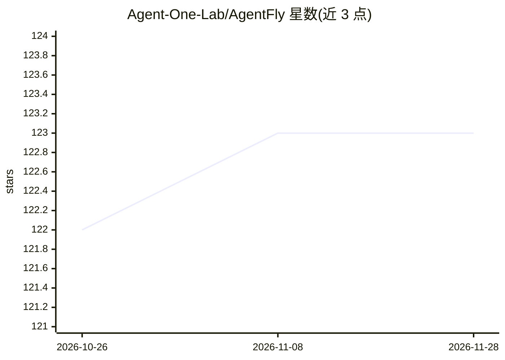

# Agent-One-Lab/AgentFly

⭐ 123 · Python · Apache-2.0 · 推送 2026-11-24 · [GitHub](https://github.com/Agent-One-Lab/AgentFly) · 组织维护 · 中文 README

**面向开发者的 LLM agent 强化学习训练框架**

用于以强化学习训练 LLM agent 的可扩展框架：通过 token 级掩码把传统 RL 方法适配到多轮训练，以装饰器接口定义工具与奖励函数，异步执行工具调用与奖励计算以支撑高吞吐训练，并提供集中式资源管理系统协调环境。训练基于 verl，附预置工具、环境与各任务的训练脚本；需 Python 3.12 与 Linux，训练场景要求多 GPU 环境。

## 筛选速览

| 维度 | 判定 | 备注 |
|---|---|---|
| AI 角色 | `ai-ecosystem` | LLM/agent 周边工具 |
| 许可风险 | `permissive` | Apache-2.0 |
| 部署形态 | `library` | 以包/库形式分发 |
| 模型依赖 | — | README 未给出锁定关系 |
| 硬件要求 | — | 无带数字的原话,不猜 |
| 安装摩擦 | `low` | 无编译、无系统依赖或容器化 |
| 成熟度 | — | 结构信号不足 |

## 能力要点

- 基于 token 掩码的多轮 RL 训练，支持 GRPO、Reinforce++ 等算法的多链推理
- @tool/@reward 装饰器定义工具与奖励，支持类方法
- 工具调用与奖励计算的异步执行及集中式资源管理
- 多模态（视觉）agent 训练与 chat-bricks 模板系统

## 适用场景

- 训练能调用搜索、代码解释器等工具的多轮对话 agent
- 在 SearchR1、WebShop、ALFWorld 等 RL 任务上训练模型
- 定制工具、奖励函数与环境以训练自有 agent
- 训练具备图像理解能力的 GUI 自动化或视觉问答 agent

## 场景标签

`多模态` `强化学习` · 领域:感知与多模态

## 证据(README 行号)

> L31: AgentFly is an extensible framework for building LLM agents with reinforcement learning. It supports multi-turn tra
> L105: ## Training

## 星数曲线

2026-10-26 122 → 2026-11-28 123（+1）

---
*卡片 v1 · prompt 1.4 · 生成 2026-11-28 · 置信度 high · 依据 README sha `655cdcd95741` · [字段定义](../../DATASET.md)*
