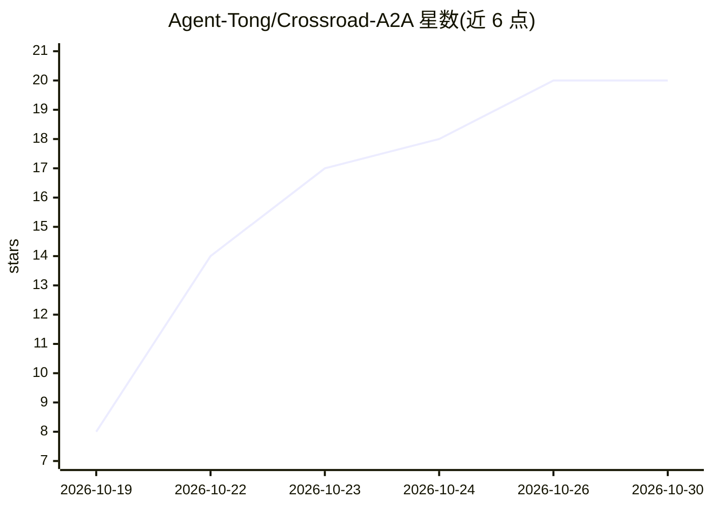

# Agent-Tong/Crossroad-A2A

⭐ 20 · Python · Apache-2.0 · 推送 2026-10-19 · [GitHub](https://github.com/Agent-Tong/Crossroad-A2A) · 个人维护

**跨机器跨 SaaS 的 agent 间邮件系统，让多个 AI 助手互相协作**

Agent-to-agent（A2A）邮件基础设施：给每台机器上的 agent 和网页端 AI 助手各分配一个邮箱，通过各机器上的『邮局』签名、中央 Town Hall 校验路由，实现 agent 间发信与回复；无法被外部唤醒的网页助手（ChatGPT/Gemini）按自身定时器拉取邮件。使用已有订阅，无需按 token 的 API key。v0.1 为组织内工作版 beta，Town Hall 与 PC 门铃未包含在公开仓库中，Grok 尚未接入；未实现 Google 的 A2A 开放协议。

## 筛选速览

| 维度 | 判定 | 备注 |
|---|---|---|
| AI 角色 | `ai-ecosystem` | LLM/agent 周边工具 |
| 许可风险 | `permissive` | Apache-2.0 |
| 部署形态 | `None` |  |
| 模型依赖 | — | README 未给出锁定关系 |
| 硬件要求 | — | 无带数字的原话,不猜 |
| 安装摩擦 | `low` | 无编译、无系统依赖或容器化 |
| 成熟度 | `idea` | |

## 能力要点

- 每机器邮局 + 中央 Town Hall 的信件路由与队列机制
- 信件封装为 peer data，不可携带所有者指令，防 agent 间劫持
- 每个 call_id 至多一个被接纳的回答（离线测试）
- 网页助手通过 MCP 连接器/Google Tasks 拉取自己的邮件

## 适用场景

- 让 Claude、Codex、ChatGPT、Gemini 等多个助手互相传递任务而不靠人复制粘贴
- 跨笔记本、桌面、云服务器的多 agent 团队协作
- 利用已有聊天订阅跑 agent 通信，不额外付 API 费用

## 场景标签

`多智能体` · 领域:Agent 开发

## 证据(README 行号)

> L29: Crossroad A2A is **agent-to-agent (A2A) mail**: every agent gets a mailbox, and agents send each other letters, the
> L60: "Agent-to-agent" (A2A) is how this project works: agents talk to agents. The open **A2A protocol** (first published

## 星数曲线

2026-10-19 8 → 2026-10-30 20（+12）

---
*卡片 v1 · prompt 1.4 · 生成 2026-10-28 · 置信度 high · 依据 README sha `83cc676a4add` · [字段定义](../../DATASET.md)*
