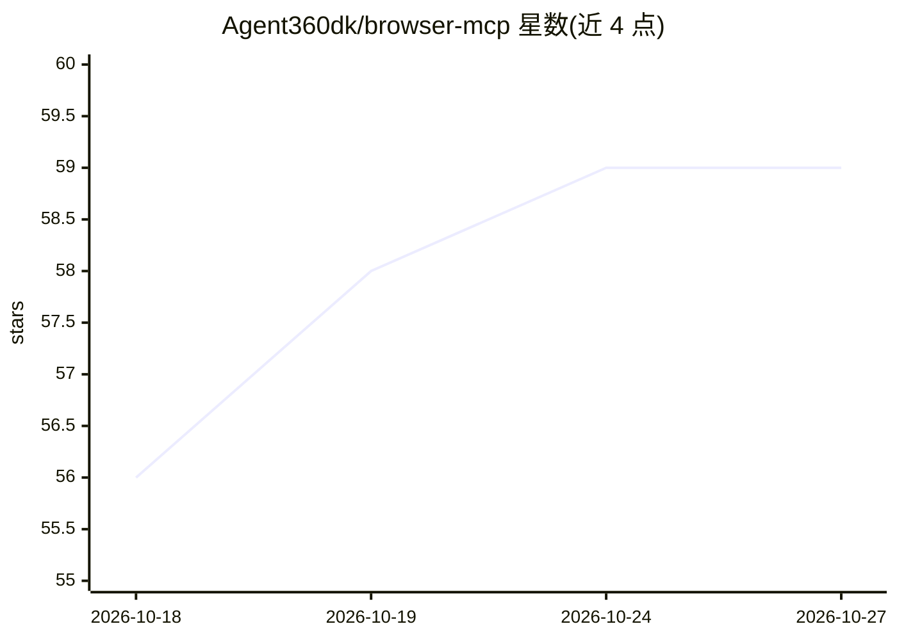

# Agent360dk/browser-mcp

⭐ 59 · JavaScript · MIT · 推送 2026-10-24 · [GitHub](https://github.com/Agent360dk/browser-mcp) · [官网](https://browsermcp.dev) · 组织维护

**让 AI agent 操控你已登录 Chrome 的 MCP 工具，遇 2FA/CAPTCHA 可暂停询问**

由 Chrome 扩展与本地 MCP server 两部分组成：扩展驱动用户已登录的真实 Chrome（复用 cookies、会话与 2FA），server 供 Claude Code、Cursor、VS Code 等 MCP 客户端调用，提供 40 个浏览器工具。支持最多 20 个并发 agent，各占独立颜色标签组；遇到登录墙可打开 Gmail 读取验证码继续登录，敏感步骤通过 browser_ask_user 暂停征询用户。MIT 许可，本地运行，无账号与遥测。已知限制：非前台标签页无法接收鼠标/键盘事件。

## 筛选速览

| 维度 | 判定 | 备注 |
|---|---|---|
| AI 角色 | `ai-ecosystem` | LLM/agent 周边工具 |
| 许可风险 | `permissive` | MIT |
| 部署形态 | `desktop` | 安装包/桌面程序 |
| 模型依赖 | — | README 未给出锁定关系 |
| 硬件要求 | — | 无带数字的原话,不猜 |
| 安装摩擦 | `low` | 无编译、无系统依赖或容器化 |
| 成熟度 | — | 结构信号不足 |

## 能力要点

- 驱动用户已登录的真实 Chrome，复用现有 cookies/会话/2FA
- browser_ask_user 人在回路：2FA、CAPTCHA、凭证输入时暂停询问用户
- 40 个工具，最多 20 个并发 agent 各占颜色标签组
- 通过 Chrome Debugger API 支持 strict CSP、跨域 iframe、shadow DOM

## 适用场景

- 操作无 API 的内部面板、管理后台与 LinkedIn 等平台
- 对自己的 Web 应用做端到端 QA 走查
- 登录墙场景下由 agent 读取邮箱验证码完成登录
- 数据抓取与看板操作时保留人工审批敏感步骤

## 场景标签

`浏览器自动化` · 领域:效率与自动化

## 证据(README 行号)

> L28: Browser MCP gives Claude Code (and MCP clients that run local servers, such as Cursor and VS Code agent mode) contr
> L46: **2 - Add the MCP server.** Paste this in a terminal. Required - the extension does nothing on its own:
> L64: > **Browser MCP is two halves and you need both:** a **Chrome extension** (drives the browser) and a **local MCP se

## 星数曲线

2026-10-18 56 → 2026-10-27 59（+3）

---
*卡片 v1 · prompt 1.4 · 生成 2026-10-24 · 置信度 high · 依据 README sha `2c5003bca07c` · [字段定义](../../DATASET.md)*
