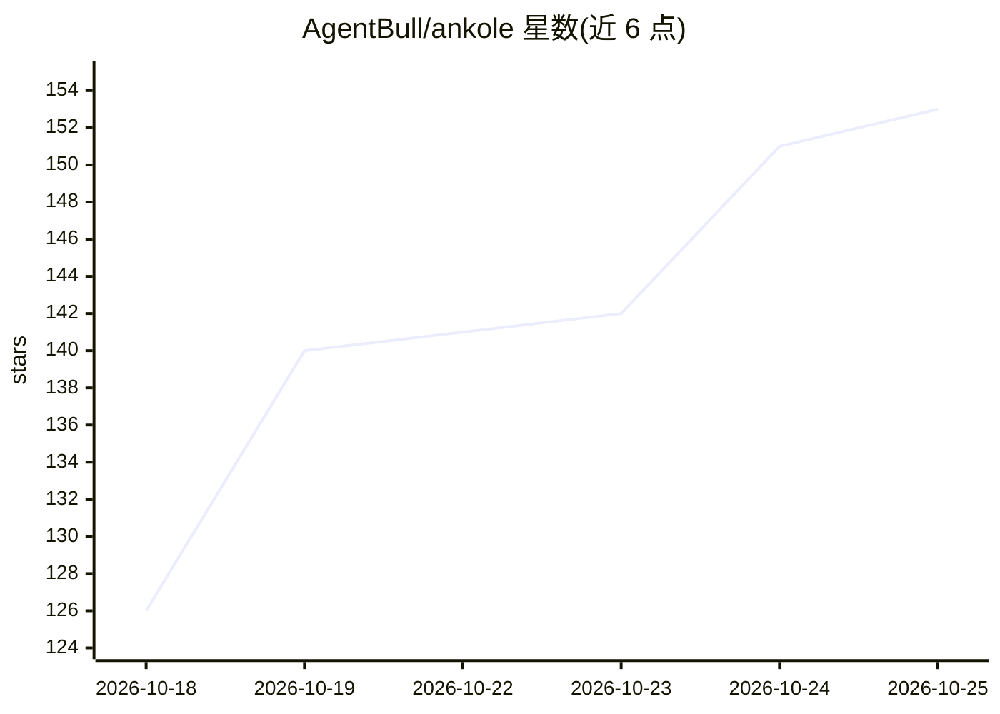

# AgentBull/ankole

⭐ 153 · Elixir · Apache-2.0 · 推送 2026-10-24 · [GitHub](https://github.com/AgentBull/ankole) · [官网](https://ankole.agentbull.com/) · 组织维护 · 中文 README

**自托管企业 AI Agent 平台，接入 Slack/Teams/飞书等聊天工具**

Elixir/OTP 控制平面驱动的自托管 Agent Harness：Agent 通过 Slack、Teams、Lark/飞书、钉钉、企业微信等聊天工具接收任务，每个 Agent 在独立 Linux 容器中运行浏览器、终端、Codex 与 MCP 服务器。Company Brain 从对话、文件和 URL 学习并存储带来源与时间的知识声明，权限按人或 Agent 隔离，长任务崩溃后可恢复。模型调用仅发往用户配置的提供商，含 OpenAI 兼容端点与国内厂商插件。部署方式为 Docker Compose、Helm 或源码，需要 Docker root 权限与模型 API key。

## 筛选速览

| 维度 | 判定 | 备注 |
|---|---|---|
| AI 角色 | `ai-ecosystem` | LLM/agent 周边工具 |
| 许可风险 | `permissive` | Apache-2.0 |
| 部署形态 | `self-host` | docker 或自建部署 |
| 模型依赖 | locked-api |  |
| 硬件要求 | — | 无带数字的原话,不猜 |
| 安装摩擦 | `low` | 无编译、无系统依赖或容器化 |
| 成熟度 | — | 结构信号不足 |

## 能力要点

- Company Brain 学习团队决策并带来源/时间/置信度存储声明
- 每个 Agent 独立 Linux 容器，可运行浏览器、终端、Codex、MCP 服务器
- Elixir/OTP 控制平面将崩溃隔离在单会话，长任务可恢复
- 支持 Slack/Teams/Lark/钉钉/企业微信等 10 种聊天与邮件渠道

## 适用场景

- 在现有聊天工具里让 Agent 执行定时报表、修 issue、翻译文档等公司事务
- 企业自建带权限隔离与审计记录的 Agent 系统
- 通过 Deep Research 生成带引用的调研简报

## 场景标签

`Agent 框架` `浏览器自动化` `知识库管理` `科研工具` · 领域:Agent 开发

## 证据(README 行号)

> L22: Ankole is an open source alternative to Claude Tag, the Slack agent that Anthropic hosts. Ankole is not tied to Sla
> L77: |Models|OpenAI, Azure OpenAI, Claude, Google AI Studio, OpenRouter, ChatGPT subscriptions, and any endpoint compati

## 星数曲线

2026-10-18 126 → 2026-10-25 153（+27）

---
*卡片 v1 · prompt 1.4 · 生成 2026-10-22 · 置信度 high · 依据 README sha `ce5f1d6a287a` · [字段定义](../../DATASET.md)*
