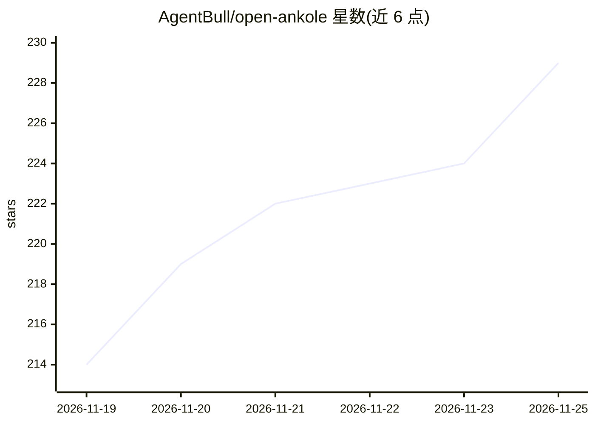

# AgentBull/open-ankole

⭐ 229 · Elixir · Apache-2.0 · 推送 2026-11-23 · [GitHub](https://github.com/AgentBull/open-ankole) · [官网](https://ankole.agentbull.com/) · 组织维护 · 中文 README

**自托管企业级 Agent Harness：在自有基础设施上运行跨 Slack/飞书等渠道的 AI Agent**

以 Elixir/OTP 控制平面加 Bun/TypeScript Worker 组成的自托管 Agent 运行平台：Company Brain 维护带来源、时间、置信度的企业知识，运行时用 Virtual Actor 支持会话唤醒、检查点、恢复与小时/天级长任务，AIGateway 统一路由 LLM/embedding/rerank 请求，并配 Vite+React 管理控制台。支持 Slack、Teams、Lark/飞书、钉钉、企业微信、Telegram 等渠道适配器与 Per-Agent token 配额、审计记录。README 提示公共 API 兼容契约仍在定义，发布可能包含 breaking changes。

## 筛选速览

| 维度 | 判定 | 备注 |
|---|---|---|
| AI 角色 | `ai-ecosystem` | LLM/agent 周边工具 |
| 许可风险 | `permissive` | Apache-2.0 |
| 部署形态 | `self-host` | docker 或自建部署 |
| 模型依赖 | locked-api |  |
| 硬件要求 | — | 无带数字的原话,不猜 |
| 安装摩擦 | `low` | 无编译、无系统依赖或容器化 |
| 成熟度 | `idea` | |

## 能力要点

- Company Brain 保存每条知识的来源、持有者、置信度并保留矛盾供审查
- Virtual Actor + OTP 监督树支持会话检查点、失败恢复与长时运行
- 覆盖 Slack/Teams/Lark/钉钉/企业微信/Telegram 等渠道适配器与 SSO 目录同步
- AIGateway 统一路由 LLM、embedding、rerank、web search 请求

## 适用场景

- 企业自托管部署跨聊天渠道的内部 Agent 助手
- 需要带来源审计的知识型决策支持（行业研究、数据分析、预测）
- 按 Agent 控制模型开销并管理员工身份与权限生命周期

## 场景标签

`聊天机器人` · 领域:对话与助手

## 证据(README 行号)

> L10: OpenAnkole is the open source Agent Harness in this repository.
> L85: The Elixir/OTP control plane owns durable decisions for Principal/AuthZ, SignalsGateway, Schedule, Actor Runtime, J
> L97: OpenAnkole runs in production as a complete enterprise Agent Harness. Companies can host the control plane, Agent C

## 星数曲线

2026-11-19 214 → 2026-11-25 229（+15）

---
*卡片 v1 · prompt 1.4 · 生成 2026-11-19 · 置信度 mid · 依据 README sha `5d4eb932a847` · [字段定义](../../DATASET.md)*
