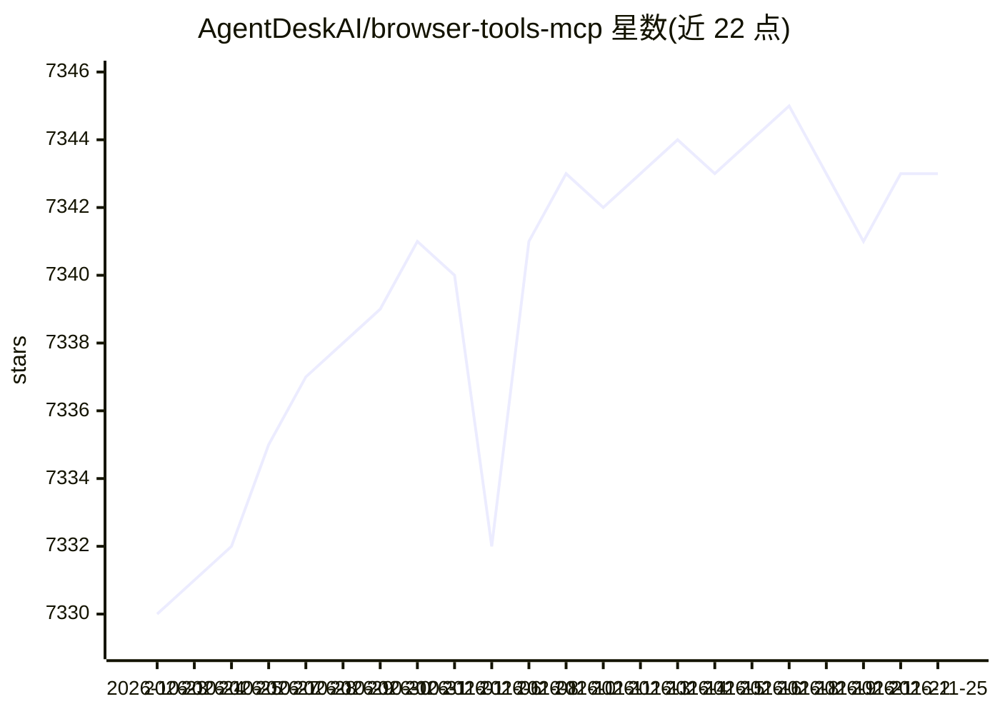

# AgentDeskAI/browser-tools-mcp

⭐ 7,343 · TypeScript · MIT · 推送 2026-10-28 · [GitHub](https://github.com/AgentDeskAI/browser-tools-mcp) · [官网](https://agentdesk.ai/) · 组织维护

**让 AI 编码代理读取真实 Chrome 会话的 MCP 服务器**

BrowserTools MCP 通过 Chrome 扩展附加到用户正在使用的浏览器会话，将控制台输出、网络请求、截图与 Lighthouse 审计流式传给 MCP 兼容客户端（Cursor、Claude Code、Windsurf 等）。提供 20 余个工具（日志读取、元素选择、导航、截图、无障碍/性能/SEO 审计），大负载以 MCP resources 形式按需获取；仅绑定回环地址、需 bearer token、对凭据做脱敏。安装需 Node 22.19+ 与加载 Chrome 扩展两步；1.x 因安全问题不再维护，须升级到 2.0。

## 筛选速览

| 维度 | 判定 | 备注 |
|---|---|---|
| AI 角色 | `ai-ecosystem` | LLM/agent 周边工具 |
| 许可风险 | `permissive` | MIT |
| 部署形态 | `library` | 以包/库形式分发 |
| 模型依赖 | — | README 未给出锁定关系 |
| 硬件要求 | — | 无带数字的原话,不猜 |
| 安装摩擦 | `low` | 无编译、无系统依赖或容器化 |
| 成熟度 | — | 结构信号不足 |

## 能力要点

- 附加到已登录的真实 Chrome 会话，而非新建自动化浏览器
- 20+ MCP 工具：控制台/网络日志、截图、Lighthouse 无障碍/性能/SEO 审计
- 凭据自动脱敏、仅绑定 127.0.0.1、per-run bearer token 认证
- 大历史数据以 MCP resources 提供，工具支持 limit/offset 与关键词过滤

## 适用场景

- 让 Cursor/Claude Code 等代理直接查看我当前调试页面的控制台报错
- 在保持登录态的会话里让代理复现和排查网络请求问题
- 对页面跑 Lighthouse 无障碍/SEO 审计并让代理解读结果

## 场景标签

`编码 Agent` · 领域:编码与开发

## 证据(README 行号)

> L8: Give your AI coding agent eyes on the browser. BrowserTools MCP streams console
> L11: client: Cursor, Claude Code, Windsurf, Cline, Zed, Gemini CLI, and others.

## 星数曲线

2026-10-23 7,330 → 2026-11-25 7,343（+13）

---
*卡片 v1 · prompt 1.4 · 生成 2026-11-22 · 置信度 high · 依据 README sha `a4124352e557` · [字段定义](../../DATASET.md)*
