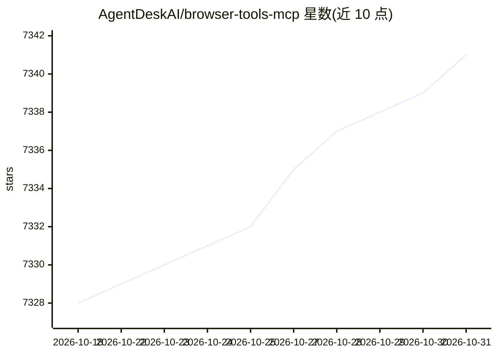

# AgentDeskAI/browser-tools-mcp

⭐ 7,341 · TypeScript · MIT · 推送 2026-10-28 · [GitHub](https://github.com/AgentDeskAI/browser-tools-mcp) · [官网](https://agentdesk.ai/) · 组织维护

**MCP 服务器：把真实 Chrome 会话的日志/网络/截图/审计流给 AI 编码代理**

面向 Cursor、Claude Code、Windsurf、Cline、Zed、Gemini CLI 等 MCP 客户端的浏览器遥测服务器：通过 Chrome DevTools 扩展附着到用户已登录的真实浏览器会话（而非 CDP 自动化新开的浏览器），向 AI 代理提供控制台日志、网络请求、截图与 Lighthouse 级性能/无障碍/SEO 审计等 17 个工具。2.0 重写为单进程，连接器仅绑定 127.0.0.1、HTTP API 需按次运行令牌认证，捕获数据中的凭证（Authorization/Cookie/JWT/云密钥）会被替换为 [REDACTED]。大体积历史以 MCP 资源形式按需读取以控制上下文窗口。要求 Node 22.19+，需手动加载未打包的 Chrome 扩展；Firefox 未验证，视为不支持。

## 筛选速览

| 维度 | 判定 | 备注 |
|---|---|---|
| AI 角色 | `ai-ecosystem` | LLM/agent 周边工具 |
| 许可风险 | `permissive` | MIT |
| 部署形态 | `library` | 以包/库形式分发 |
| 模型依赖 | — | README 未给出锁定关系 |
| 硬件要求 | — | 无带数字的原话,不猜 |
| 安装摩擦 | `low` | 无编译、无系统依赖或容器化 |
| 成熟度 | — | 结构信号不足 |

## 能力要点

- 附着到已登录的真实 Chrome 会话而非自动化新开浏览器
- 17 个工具覆盖控制台/网络/元素/截图/存储与 4 类 Lighthouse 审计
- 遥测按 tab 归属，大历史走 MCP resources 按需读取
- 凭证抓取即脱敏、连接器仅绑定环回地址、按次运行令牌认证

## 适用场景

- 让 AI 编码代理直接看到我正在调试页面的报错和请求
- 通过代理对话对页面跑性能/无障碍/SEO 审计
- 在已登录状态下让代理排查前端问题而无需重建认证环境

## 场景标签

 · 领域:开发者工具/浏览器遥测

## 证据(README 行号)

> L3: Give your AI coding agent eyes on the browser. BrowserTools MCP streams console
> L5: Chrome session** — the one already logged into your app — to any MCP-compatible

## 星数曲线

2026-10-18 7,328 → 2026-10-31 7,341（+13）

---
*卡片 v1 · prompt 1.4 · 生成 2026-10-20 · 置信度 high · 依据 README sha `9b0c2e240433` · [字段定义](../../DATASET.md)*
