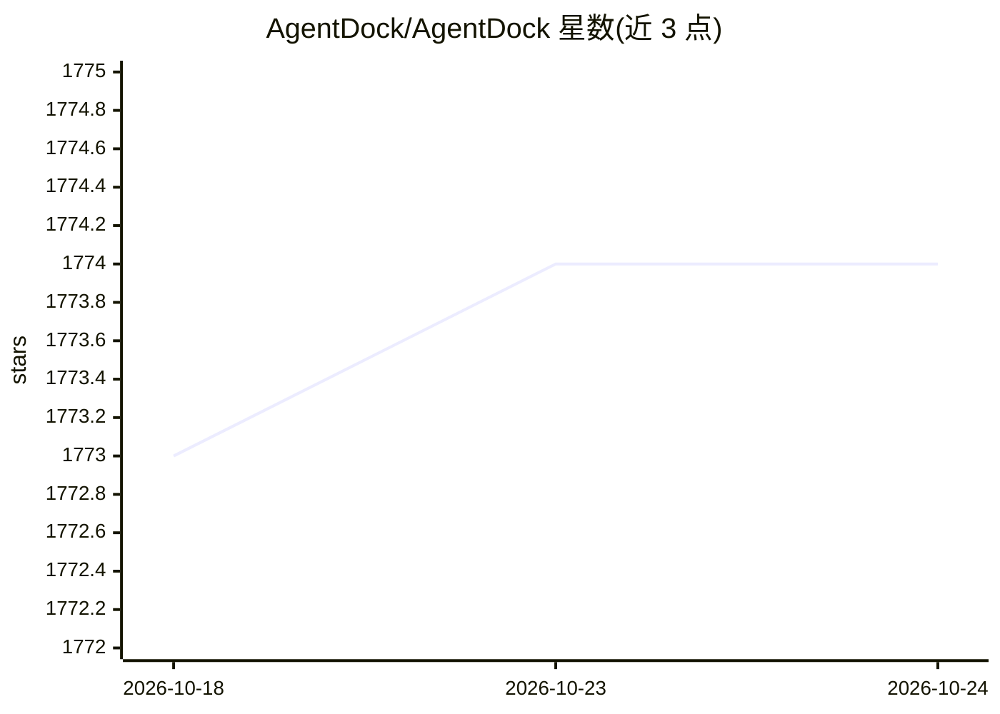

# AgentDock/AgentDock

⭐ 1,772 · MDX · MIT · 推送 2026-07-14 · [GitHub](https://github.com/AgentDock/AgentDock) · [官网](https://agentdock.ai) · 组织维护

**构建可配置确定性 AI agent 的 TypeScript 后端框架**

AgentDock Core 是开源的后端优先 agent 构建框架，基于节点化架构（BaseNode/AgentNode/工具节点），主打"可配置确定性"：开发者可设定哪些环节使用 LLM 推理、哪些走确定性工作流路径。附带一个 Next.js 开源客户端作为参考实现，可部署到 Vercel。支持会话管理、编排框架、可插拔存储（KV/向量/安全存储，部分仍在开发）与评测框架。README 标注 Beta；仓库描述声明框架已退役，提示词库与图书已迁移至其他仓库。

## 筛选速览

| 维度 | 判定 | 备注 |
|---|---|---|
| AI 角色 | `ai-ecosystem` | LLM/agent 周边工具 |
| 许可风险 | `permissive` | MIT |
| 部署形态 | `library` | 以包/库形式分发 |
| 模型依赖 | locked-api |  |
| 硬件要求 | — | 无带数字的原话,不猜 |
| 安装摩擦 | `low` | 无编译、无系统依赖或容器化 |
| 成熟度 | `idea` | |

## 能力要点

- 节点化架构：BaseNode/AgentNode/工具皆为实现为节点
- 可配置确定性：可控制 LLM 推理与确定性工作流的边界
- 存储抽象层：KV（Memory/Redis/Vercel KV）、向量与安全存储可插拔
- 含 Next.js 开源客户端与多个预配置 agent 模板

## 适用场景

- 构建需要平衡 LLM 创造性与可预测执行路径的 agent 应用
- 基于参考客户端快速起一个可对话的 agent 站点
- 用评测框架系统度量 agent 质量

## 场景标签

`Agent 框架` · 领域:Agent 开发

## 证据(README 行号)

> L13: AgentDock is a framework for building sophisticated AI agents that deliver complex tasks with **configurable determ
> L15: 1. **AgentDock Core**: An open-source, backend-first framework for building and deploying AI agents. It's designed 
> L19: Built with TypeScript, AgentDock emphasizes *simplicity*, *extensibility*, and ***configurable determinism*** - mak

## 星数曲线

2026-10-18 1,773 → 2026-10-24 1,774（+1）

---
*卡片 v1 · prompt 1.4 · 生成 2026-10-21 · 置信度 mid · 依据 README sha `a062053d3071` · [字段定义](../../DATASET.md)*
