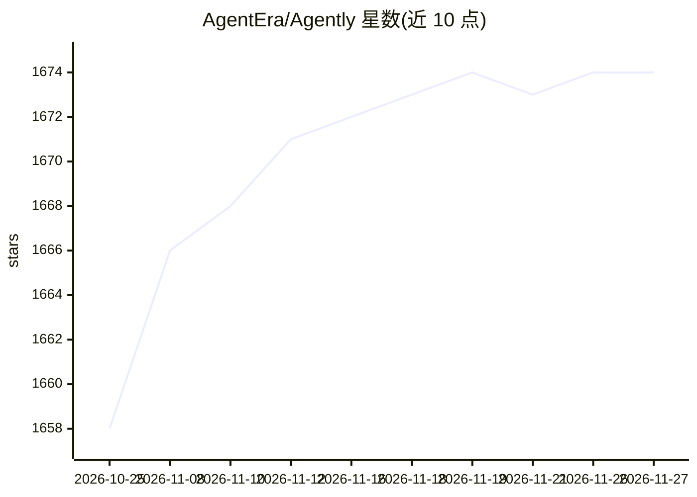

# AgentEra/Agently

⭐ 1,674 · Python · Apache-2.0 · 推送 2026-11-12 · [GitHub](https://github.com/AgentEra/Agently) · [官网](http://agently.tech) · 组织维护

**Python AI 应用运行时框架：构建可靠 GenAI 服务后端**

面向从模型原型走向可靠应用的工程团队，提供 Python 运行时框架：结构化输出契约（.output schema、字段校验、重试）、可观测 Actions 与运行时 Skills、MCP 能力、事件驱动的 TriggerFlow 工作流（支持暂停/恢复/快照）、模型池切换及 FastAPI 服务化辅助。统一 provider 设置与响应解析契约，使更换模型不需重写业务逻辑。要求 Python ≥3.10，pip 安装。

## 筛选速览

| 维度 | 判定 | 备注 |
|---|---|---|
| AI 角色 | `ai-ecosystem` | LLM/agent 周边工具 |
| 许可风险 | `permissive` | Apache-2.0 |
| 部署形态 | `library` | 以包/库形式分发 |
| 模型依赖 | local-ok | 支持本地模型 |
| 硬件要求 | — | 无带数字的原话,不猜 |
| 安装摩擦 | `low` | 无编译、无系统依赖或容器化 |
| 成熟度 | — | 结构信号不足 |

## 能力要点

- 统一请求/运行时契约，切换模型供应商无需重写业务逻辑
- 结构化输出框架级保障：schema、ensure_keys、校验与重试
- TriggerFlow 事件驱动工作流：fan-out、暂停/恢复、保存/加载
- instant 流式模式在最终 token 前暴露结构化字段

## 适用场景

- 构建 AI 助手、内部 copilot 或知识类后端服务
- 搭建需要在更换模型后保持稳定的 AI API 服务
- 用 TriggerFlow 编排带人工介入的多步骤 GenAI 流程
- 为复杂模型应用补充可观测性与调试能力

## 场景标签

`Agent 框架` · 领域:Agent 开发

## 证据(README 行号)

> L3: # Agently 4.1.4.11 - AI Application Runtime Framework
> L5: > Build AI service backends with structured outputs, observable Actions, runtime Skills, MCP capabilities, process s
> L22: Agently is for teams moving from "the model can do it once" to "the application must do it reliably":

## 星数曲线

2026-10-25 1,658 → 2026-11-27 1,674（+16）

---
*卡片 v1 · prompt 1.4 · 生成 2026-11-23 · 置信度 high · 依据 README sha `69332eb9384c` · [字段定义](../../DATASET.md)*
