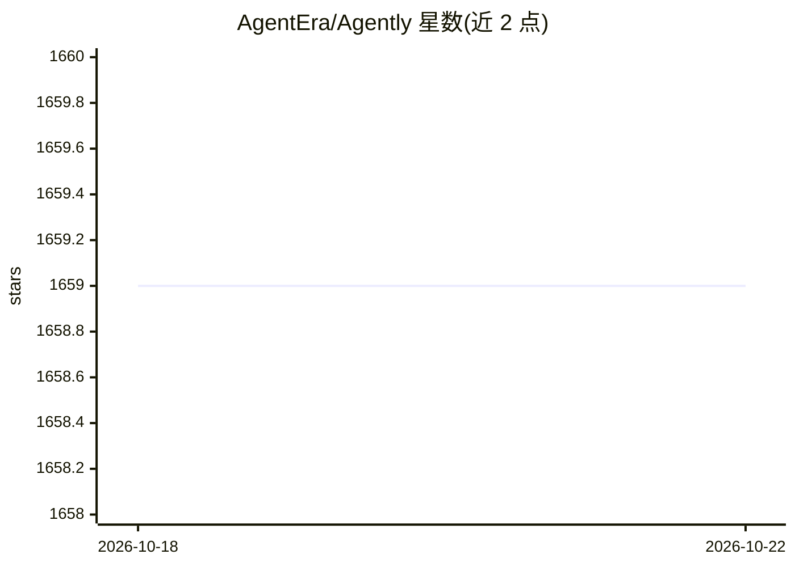

# AgentEra/Agently

⭐ 1,658 · Python · Apache-2.0 · 推送 2026-10-13 · [GitHub](https://github.com/AgentEra/Agently) · [官网](http://agently.tech) · 组织维护 · 中文 README

**面向工程化落地的 AI 应用运行时框架**

Python（≥3.10）AI 应用开发框架，供从原型走向可靠服务的团队使用：以统一请求/运行时契约封装模型接入、提示槽位、结构化输出解析、重试校验、Action Runtime（含 MCP、shell/Python/Node/SQLite 执行）、运行时 Skills、TriggerFlow 事件驱动工作流（暂停/恢复/快照）与 FastAPI 服务暴露。支持切换模型不重写业务逻辑、模型池、instant 流式结构化输出。README 提供与 LangChain/LangGraph 等的定位对比。

## 筛选速览

| 维度 | 判定 | 备注 |
|---|---|---|
| AI 角色 | `ai-ecosystem` | LLM/agent 周边工具 |
| 许可风险 | `permissive` | Apache-2.0 |
| 部署形态 | `library` | 以包/库形式分发 |
| 模型依赖 | local-ok | 支持本地模型 |
| 硬件要求 | — | 无带数字的原话,不猜 |
| 安装摩擦 | `low` | 无编译、无系统依赖或容器化 |
| 成熟度 | — | 结构信号不足 |

## 能力要点

- 统一请求契约下切换模型提供方无需重写业务逻辑
- 结构化输出由框架保证（schema 提示、重试、校验处理器）
- TriggerFlow 事件驱动工作流支持暂停/恢复与快照
- Action Runtime 支持 MCP、shell/Python/Node/SQLite 等可观察 Action

## 适用场景

- 构建助手、内部 copilot、知识工具等 AI 服务后端
- 在多个模型提供方之间切换而保持业务代码稳定
- 以事件驱动工作流管理复杂 GenAI 执行逻辑
- 用 FastAPI 暴露流式结构化输出服务

## 场景标签

`Agent 框架` `工作流自动化` · 领域:Agent 开发

## 证据(README 行号)

> L3: # Agently 4.1.4.10 - AI Application Runtime Framework
> L5: > Build AI service backends with structured outputs, observable Actions, runtime Skills, MCP capabilities, process s
> L56: - **Model switching should not rewrite business logic** - Agently normalizes provider setup, prompt slots, response

## 星数曲线

2026-10-18 1,659 → 2026-10-22 1,659（+0）

---
*卡片 v1 · prompt 1.4 · 生成 2026-10-21 · 置信度 high · 依据 README sha `21a920df6920` · [字段定义](../../DATASET.md)*
