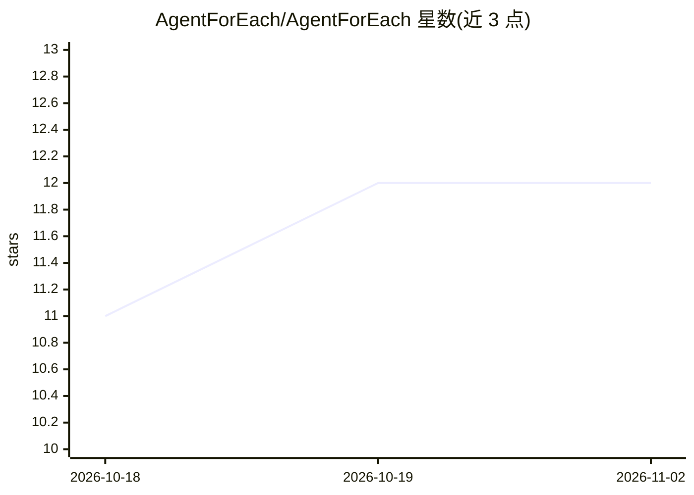

# AgentForEach/AgentForEach

⭐ 12 · TypeScript · Apache-2.0 · 推送 2026-10-27 · [GitHub](https://github.com/AgentForEach/AgentForEach) · 组织维护

**为每个用户运行一个 AI agent 的多租户运行时平台**

面向应用开发者的个人 agent 基础设施：一个共享运行时为应用的每个用户提供独立 agent，内置用户隔离的记忆、定时任务、审批（human-in-the-loop）、频道（Web/Telegram/WhatsApp）、Markdown 技能与私有沙箱浏览器。基于六大平台契约，可在 Azure、Cloudflare 或 AWS 上以无服务器架构部署，空闲 agent 仅占用存储成本。支持 OpenAI、Azure OpenAI、Anthropic、Amazon Bedrock 等模型提供方，与托管云独立配置。AWS 支持处于 preview 阶段。

## 筛选速览

| 维度 | 判定 | 备注 |
|---|---|---|
| AI 角色 | `ai-ecosystem` | LLM/agent 周边工具 |
| 许可风险 | `permissive` | Apache-2.0 |
| 部署形态 | `None` |  |
| 模型依赖 | locked-api |  |
| 硬件要求 | — | 无带数字的原话,不猜 |
| 安装摩擦 | `low` | 无编译、无系统依赖或容器化 |
| 成熟度 | `idea` | |

## 能力要点

- 用户级隔离的记忆、会话、日程与沙箱，多租户共享运行时
- 六大平台契约映射到 Azure / Cloudflare / AWS 三套云实现
- 审批与人回环：表单暂停工作、重连恢复待答表单
- 每个 agent 配有沙箱内 Chromium 浏览器，支持登录/CAPTCHA 实时交接

## 适用场景

- 为自己的应用每个用户提供带长期记忆的个人 agent
- 银行/电信等企业给每位客户配独立 agent 并加审批步骤
- 为公司全员部署可调用内部 API 的员工助手

## 场景标签

`Agent 记忆` `Agent 框架` · 领域:Agent 开发

## 证据(README 行号)

> L7:  Give every user an agent that remembers them, follows up while they're away and uses tools on their behalf. You bui
> L86:  Three layers, shown on Azure: your product supplies the app, brand, sign-in, personality and skills; AgentForEach 
> L142:  Agent runtime Streaming, tool loops, deadlines and model failover. OpenAI, Azure OpenAI, Anthropic, Amazon Bedroc

## 星数曲线

2026-10-18 11 → 2026-11-02 12（+1）

---
*卡片 v1 · prompt 1.4 · 生成 2026-11-01 · 置信度 high · 依据 README sha `2d6f166c4037` · [字段定义](../../DATASET.md)*
