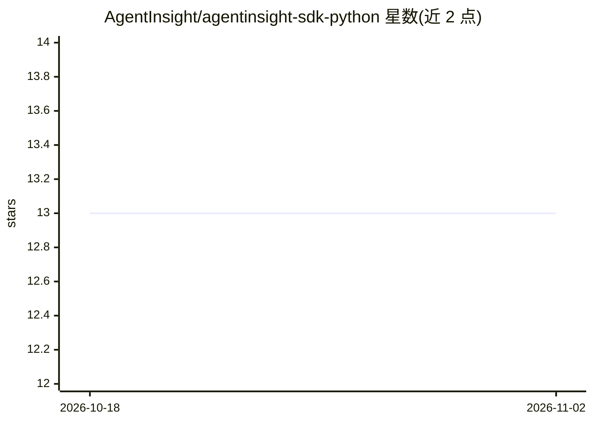

# AgentInsight/agentinsight-sdk-python

⭐ 13 · Python · MIT · 推送 2026-07-06 · [GitHub](https://github.com/AgentInsight/agentinsight-sdk-python) · [官网](https://agentinsight.goldebridge.com/platform) · 组织维护 · 中文 README

**AgentInsight 平台的 Python SDK：LLM 应用追踪、评估与 Prompt 管理**

为 AgentInsight 可观测性平台提供的 Python 客户端，基于 OpenTelemetry 标准构建，面向接入 LLM 应用的开发者。提供三种集成方式：OpenAI/LangChain 自动埋点（改一行 import）、@observe 装饰器、直接 SDK 调用。功能含自动追踪、NUMERIC/BOOLEAN/CATEGORICAL 评分与批量评估、跨服务上下文传播、版本化 Prompt 管理、数据集与 A/B 实验框架、多项目隔离。需连接 AgentInsight 服务端（默认 agent.goldebridge.com），要求 Python >= 3.10。项目声明由 Langfuse Python SDK 演化而来。

## 筛选速览

| 维度 | 判定 | 备注 |
|---|---|---|
| AI 角色 | `ai-ecosystem` | LLM/agent 周边工具 |
| 许可风险 | `permissive` | MIT |
| 部署形态 | `library` | 以包/库形式分发 |
| 模型依赖 | — | README 未给出锁定关系 |
| 硬件要求 | — | 无带数字的原话,不猜 |
| 安装摩擦 | `low` | 无编译、无系统依赖或容器化 |
| 成熟度 | — | 结构信号不足 |

## 能力要点

- OpenAI / LangChain 一行 import 自动埋点，捕获 prompts/completions、token 用量与成本
- @observe 装饰器与低级 span API，支持 9 种观测类型（generation/agent/tool/chain 等）
- 内置评估框架、数据集管理与 A/B 实验框架
- 基于 OpenTelemetry Baggage 的跨服务上下文传播与多项目隔离

## 适用场景

- 给 LLM 应用接入追踪，记录每次调用的输入输出与成本
- 对 LLM 应用做批量评估与 A/B 实验
- 跨微服务的 Agent 链路做上下文传播与统一观测

## 场景标签

`LLM 可观测性` `提示工程` `模型评测` · 领域:Agent 开发

## 证据(README 行号)

> L15: AgentInsight Python SDK provides a Python client for the AgentInsight platform, supporting LLM application observab
> L19: - 🤖 **LLM Auto-Instrumentation (Recommended)** — Out-of-the-box OpenAI and LangChain integrations; change a single 

## 星数曲线

2026-10-18 13 → 2026-11-02 13（+0）

---
*卡片 v1 · prompt 1.4 · 生成 2026-10-31 · 置信度 high · 依据 README sha `d43864c53c9e` · [字段定义](../../DATASET.md)*
