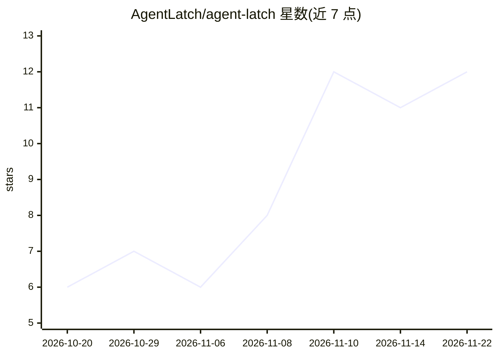

# AgentLatch/agent-latch

⭐ 12 · Python · MIT · 推送 2026-11-21 · [GitHub](https://github.com/AgentLatch/agent-latch) · 组织维护

**给 AI agent 项目做本地安全扫描与 MCP 流量记录的工具**

本地优先的 AI agent 安全工具包，含两部分：静态扫描器读取 Python agent 代码、manifest 与 prompt 模板，输出终端/JSON/SARIF 报告，可映射到 OWASP Agentic ASI01–ASI10，支持 pre-commit 与 GitHub Actions 在 CI 中按阈值失败；运行时代理置于 agent 与 MCP 服务器之间，记录 tool list/call/prompt 流量并掩码密钥，附带哈希链防篡改账本（均为 preview）。项目自述为早期概念验证，仅报告不拦截，全部在本地运行，唯一网络使用是可选的依赖审计。

## 筛选速览

| 维度 | 判定 | 备注 |
|---|---|---|
| AI 角色 | `ai-ecosystem` | LLM/agent 周边工具 |
| 许可风险 | `permissive` | MIT |
| 部署形态 | `self-host` | docker 或自建部署 |
| 模型依赖 | — | README 未给出锁定关系 |
| 硬件要求 | — | 无带数字的原话,不猜 |
| 安装摩擦 | `low` | 无编译、无系统依赖或容器化 |
| 成熟度 | `idea` | |

## 能力要点

- 静态扫描输出终端/JSON/SARIF，映射 OWASP Agentic ASI01–ASI10
- MCP 运行时代理记录工具调用并掩码密钥（ALR03/ALR04/ALR10 四道 preview 门）
- 提供 CLI、pre-commit hook、GitHub Action 与容器镜像多种运行方式
- 哈希链密封运行日志，可验证记录未被篡改

## 适用场景

- 在本机扫描 agent 项目，发现 prompt 注入、过度授权工具与硬编码密钥
- 在 pull request 中按严重度阈值拦截风险变更
- 记录并审计 agent 对 MCP 工具的实际调用流量
- 验证运行日志未被编辑或删除

## 场景标签

`网络安全` · 领域:学习与行业

## 证据(README 行号)

> L10: **Find selected security risks in AI-agent projects before you run them, and see what your agent does with its MCP 
> L13: - **Runtime proxy for MCP, preview** (`agent-latch-runtime`): sits between an AI agent and a Model Context Protocol
> L17: > **Project status: early proof of concept.** AgentLatch is not a complete vulnerability scanner, runtime protectio

## 星数曲线

2026-10-20 6 → 2026-11-22 12（+6）

---
*卡片 v1 · prompt 1.4 · 生成 2026-11-19 · 置信度 mid · 依据 README sha `a0d62a09dd49` · [字段定义](../../DATASET.md)*
