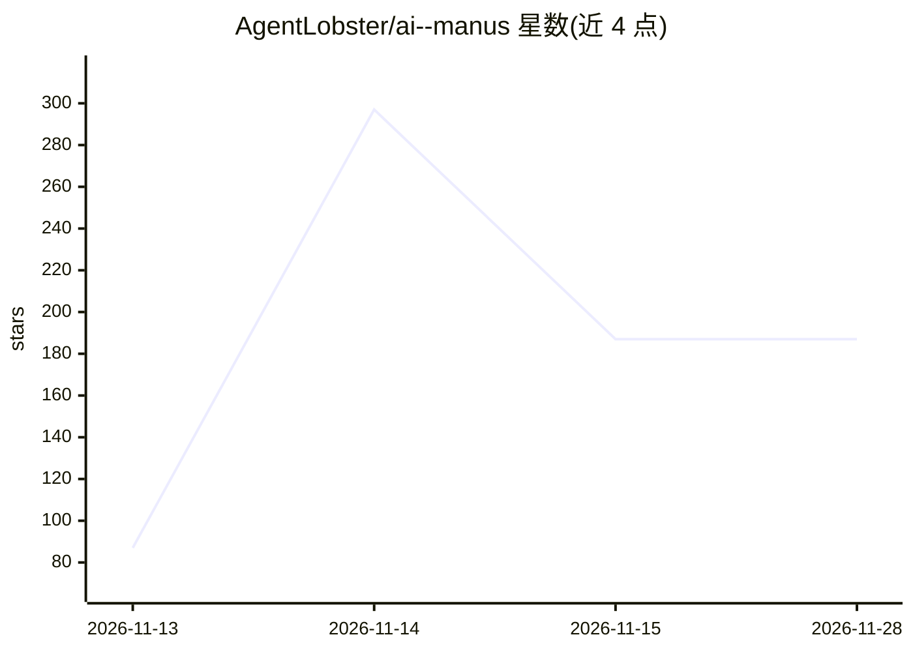

# AgentLobster/ai--manus

⭐ 187 · Apache-2.0 · 推送 2026-11-15 · [GitHub](https://github.com/AgentLobster/ai--manus) · 个人维护

**面向日常任务的自主 AI Agent：自行运行代码并控制浏览器**

Manus 是一个自主 AI Agent 系统，用户以自然语言下达指令后，Agent 可自行编写并执行脚本、打开网页、与页面元素交互，完成多步骤任务，无需用户编写完整程序。定位为家庭、学习与轻量办公场景的后台个人助手，而非企业平台。README 描述了配置步骤与硬件兼容表（最低 4 GB 内存、双核 CPU），但未给出安装命令、技术栈或源码运行方式。

## 筛选速览

| 维度 | 判定 | 备注 |
|---|---|---|
| AI 角色 | `ai-native` | 本体是模型或模型工具 |
| 许可风险 | `permissive` | Apache-2.0 |
| 部署形态 | `None` |  |
| 模型依赖 | — | README 未给出锁定关系 |
| 硬件要求 | — | 无带数字的原话,不猜 |
| 安装摩擦 | `low` | 无编译、无系统依赖或容器化 |
| 成熟度 | — | 结构信号不足 |

## 能力要点

- 自主执行代码与控制浏览器完成多步骤任务
- 以自然语言指令驱动，无需编程背景
- 面向家庭、学习与轻量办公的小规模任务场景
- 提供硬件兼容性表（最低双核 CPU / 4 GB 内存）

## 适用场景

- 让学生自动收集参考资料并运行小脚本
- 远程工作者用浏览器控制从多页面采集数据
- 把重复性的小任务委托给后台助手处理

## 场景标签

`AI 助手` `浏览器自动化` `编码 Agent` · 领域:效率与自动化

## 证据(README 行号)

> L10: - **Autonomous Code Execution:** Manus AI agent runs code on its own to complete tasks, so you can focus on decisio
> L18: Manus is an autonomous AI agent designed to run code and control a browser on your behalf. Instead of acting like a

## 星数曲线

2026-11-13 87 → 2026-11-28 187（+100）

---
*卡片 v1 · prompt 1.4 · 生成 2026-11-17 · 置信度 low · 依据 README sha `0f78ee3a5dd2` · [字段定义](../../DATASET.md)*
